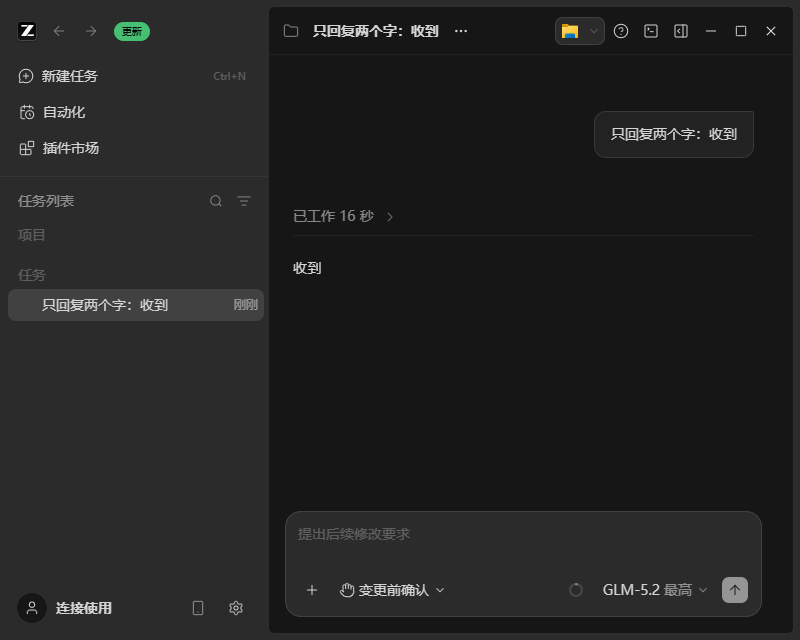
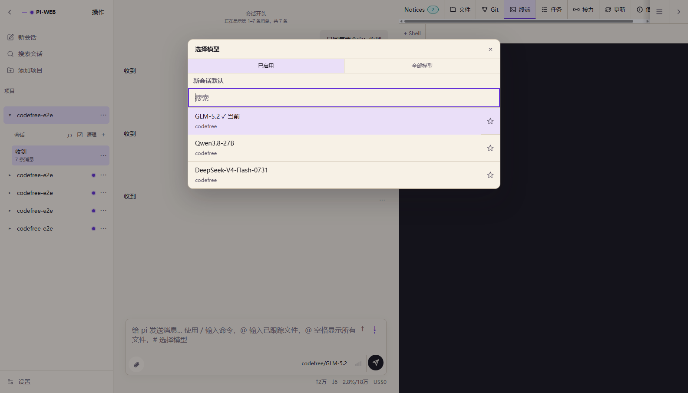
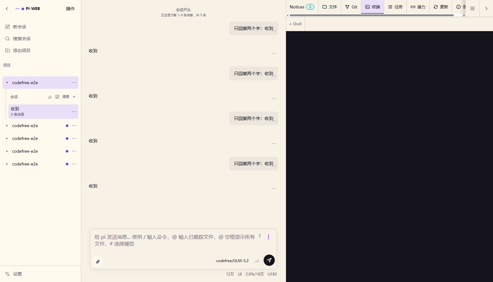

# CodeFree-O → OpenAI 兼容代理

将本机已登录的 **CodeFree-O** 内部请求封装为 OpenAI Chat Completions 兼容接口，
供其它客户端（PI / pi-web、各类 OpenAI SDK、自动化脚本等）复用同一份 CodeFree 登录态。

- 适配版本：**CodeFree-O Desktop 1.10.x**（Electron + opencode 内核，实测 1.10.1）
- 兼容旧版：1.7.x CLI 时代的凭据文件格式与刷新协议保持不变
- 运行平台：Windows / Linux（Node.js ≥ 20，依赖内置 `fetch`）

> **公开发行版说明**：本仓库为脱敏公开快照，不包含上游客户端逆向得到的 appId/secret/签名密钥与真实账号信息。
> 运行前请通过 `config.json` 或环境变量（`CODEFREE_CLIENT_ID` / `CODEFREE_CLIENT_SECRET` / `CODEFREE_SIGNING_SECRET`）自行配置
> （从本机 CodeFree-O 客户端合法获取，仅限合规用途）。内部完整版另行维护。

> **公开版仓库**：<https://github.com/RishengQi/codefree-o-proxy>（脱敏快照，不含上游
> appId/secret/签名密钥与真实账号信息）。本私有仓库 `codefree-o-proxy-private` 保留完整历史
> 与内部配置约定；公开版由 `scripts/export-public.mjs` 生成，请勿把私有历史直接推送到公开仓库。

## 原理（从 CodeFree-O 1.10.1 客户端逆向）

### 1. 登录态与凭据文件

桌面端把登录态写在：

```
Windows: %USERPROFILE%\.codefree-o\.local\share\codefree.json
Linux  : ~/.codefree-o/.local/share/codefree.json
```

文件为 v2 结构，**只保存加密后的 refresh token**，不保存 access token：

```json
{
  "version": 2,
  "encryptedRefreshCfToken": "v1:<iv>:<ciphertext>:<tag>",
  "refreshCfTokenExpiresAt": 1794880837266,
  "userId": "10001",
  "baseUrlSnapshot": "https://www.srdcloud.cn"
}
```

- 加密：AES-256-GCM，key = SHA256(`codefree-o-refresh-token-local-encryption-key-v1`)
- 页面上也允许明文 v2（`refreshCfToken` 字段），代理两种都能读。

### 2. 刷新 token（轮换制）

```
POST {base}/api/usercenterbackend/oauth/access_token
Content-Type: application/x-www-form-urlencoded

grant_type=refresh_x_cf_token
&client_id=<appId>
&x_cf_refresh_token=<refresh token>
&client_secret=<secret>
```

响应含 `x_cf_token`（默认 30 分钟）、`x_cf_refresh_token`（默认 7 天，**每次刷新都会轮换**）、
`x_cf_token_expires_in`、`x_cf_refresh_token_expires_in`、`id`。

> ⚠️ refresh token 轮换意味着：代理每次刷新后**必须把新 refresh token 写回 `codefree.json`**，
> 否则桌面端下一次刷新会失败。代理已按桌面端 `persistable()` 的格式原子写回（临时文件 + rename），
> 并在写回前检查文件是否已被桌面端轮换（重读后重试），可安全共存。

### 3. 请求签名

每个上游业务请求需要四件套：

```
X-Cf-AppId   = appId（client_id）
X-Cf-Timestamp = 秒级时间戳
X-Cf-Nonce   = 随机 UUID
X-Cf-Signature = base64(HMAC-SHA256(key=base64decode(signing_secret),
                               msg = "METHOD\nappId\ntimestamp\nnonce"))
```

另有 `X-Cf-Token: <access token>`、`userId`、`projectId: 0`、
`clientType: codefree-o`、`clientVersion: <版本号>`。

### 4. 上游接口

| 用途 | 方法与路径 |
|------|-----------|
| 聊天（OpenAI 兼容，SSE） | `POST {base}/api/acbackend/codechat/v1/completions` |
| 模型发现 | `GET {base}/api/acbackend/modelmgr/v1/clients/codefree-o/versions/{VERSION}` |
| 额度查询 | `GET {base}/api/aebackend/quota/v1/me` |
| 向量（Embedding） | `POST {base}/api/aebackend/codefree-embedding-svc/v1/text-to-embedding-vector` |

聊天请求额外头：`X-Codefree-Quota-Schema: 1`、`modelName`、`subService`、可选 `sessionId`。
上游响应本身已是 OpenAI `chat.completion` / SSE chunk 结构，代理主要做鉴权头注入与透传。

### 5. 额度语义（多账号池的基础）

**额度查询**返回（实测）：

```json
{
  "level": { "level": "L3", "displayName": "L3" },
  "vip": false,
  "quotaStatus": "BYPASSED",          // BYPASSED = 当前不受额度限制；其余状态按窗口限额
  "statusReason": "OUTSIDE_GRAY_SCOPE",
  "fiveHour": null,                    // 5 小时窗口：{ used, limit, usagePercent, resetAt, ... }
  "sevenDay": null,                    // 7 天窗口
  "quotaWorkTime": { "timeZone": "Asia/Shanghai", "startTime": "08:30", "endTime": "17:30" },
  "canUpgrade": false
}
```

**聊天响应内联额度信号**（带 `X-Codefree-Quota-Schema: 1` 时）：

- SSE 帧里可能出现 `{ "data": { "codefree": { "notifications": [ { "type": "QUOTA_WARNING",
  "period": "5H" | "7D", "usagePercent": 85, "resetAt": ..., "used": ..., "limit": ... } ] } } }`
- 额度耗尽时返回 HTTP 429，body 为 `{ "code": "AI_QUOTA_EXHAUSTED", "periods": ["5H"],
  "exhaustedMask": 1, "periodDetails": { ... }, "used": ..., "limit": ..., "resetAt": ..., "retryAt": ... }`

代理会把这两类信号落成 `account.lastQuota`（见 `/health` 与 `/v1/quota`），
可直接用于「按剩余额度择号、自动切换账号」。

## 快速开始（Windows）

1. 打开 CodeFree-O 桌面端并登录（必须，否则没有 `codefree.json`）。
2. 确认 Node ≥ 20：`node -v`
3. 启动代理：

```powershell
cd <repo>
node server.mjs            # 或 npm start
# 自检（刷新 token + 拉模型 + 查额度）
node server.mjs --check    # 或 npm run check
```

默认监听 `127.0.0.1:8787`。日志为单行 JSON，token 全部脱敏。

## 快速开始（Linux / systemd）

```bash
cp codefree-o-proxy.service /etc/systemd/system/
systemctl daemon-reload
systemctl enable --now codefree-o-proxy
systemctl status codefree-o-proxy
journalctl -u codefree-o-proxy -f
```

手动调试：`node server.mjs`。要求 Node ≥ 20（系统自带 node16 无全局 fetch，请用 nvm 的 node）。

## 配置项（环境变量）

| 变量 | 默认值 | 说明 |
|------|--------|------|
| `PORT` | `8787` | 监听端口 |
| `HOST` | `127.0.0.1` | 监听地址 |
| `CODEFREE_BASE_URL` | `https://www.srdcloud.cn` | 上游基址（dev/test/latest） |
| `CODEFREE_AUTH_FILE` | `~/.codefree-o/.local/share/codefree.json` | 凭据文件 |
| `CODEFREE_AUTH_FILES` | 空 | 额外凭据文件（英文逗号分隔，供多账号池使用） |
| `CODEFREE_SYNC_AUTH_FILE` | `true` | 刷新后是否写回凭据文件 |
| `CODEFREE_VERSION` | `1.10.1` | 客户端版本号（同时用于模型发现路径） |
| `CODEFREE_SUB_SERVICE` | `codefree_o_chat` | 上报的 subService |
| `CODEFREE_CLIENT_ID` / `CODEFREE_CLIENT_SECRET` | 内置 | 客户端 appId / secret |
| `CODEFREE_SIGNING_SECRET` | 内置 | 请求签名密钥 |
| `CODEFREE_MODEL_TTL_MS` | `60000` | 模型列表缓存 |
| `CODEFREE_QUOTA_TTL_MS` | `15000` | 额度查询缓存 |
| `CODEFREE_TIMEOUT_MS` | `180000` | 上游超时 |
| `CODEFREE_DEBUG` | 空 | `1` 打开 debug 日志 |
| `CODEFREE_STATE_FILE` | `./.auth-state.json` | 运行状态快照（gitignore） |

## 对外接口

| 方法 | 路径 | 说明 |
|------|------|------|
| GET | `/`、`/health` | 健康状态、账号、token 剩余时间、最近额度信号 |
| GET | `/v1/models` | OpenAI 模型列表（`?refresh=1` 强制刷新） |
| POST | `/v1/chat/completions` | OpenAI 对话，支持 `stream: true` SSE 透传 |
| GET | `/v1/quota` | CodeFree 额度快照（`?refresh=1` 强制刷新） |
| POST | `/v1/embeddings` | 透传 CodeFree 向量接口 |

```bash
curl http://127.0.0.1:8787/health

curl -X POST http://127.0.0.1:8787/v1/chat/completions \
  -H 'Content-Type: application/json' \
  -d '{"model":"GLM-5.2","messages":[{"role":"user","content":"你好"}]}'

curl http://127.0.0.1:8787/v1/quota

curl -N -X POST http://127.0.0.1:8787/v1/chat/completions \
  -H 'Content-Type: application/json' \
  -d '{"model":"GLM-5.2","stream":true,"messages":[{"role":"user","content":"数到3"}]}'
```

## 错误语义

| HTTP | type / code | 含义 | 处理建议 |
|------|-------------|------|----------|
| 401 | `auth_expired` / `codefree_auth_expired` | refresh token 过期或被拒 | 重新登录 CodeFree-O 客户端 |
| 429 | `quota_exhausted` / `AI_QUOTA_EXHAUSTED` | 账号额度用尽（5H/7D 窗口） | 换号或等 `resetAt`；多账号池可自动切换 |
| 502 | `codefree_error` / `upstream_error` | 上游业务失败（含 `retCode`） | 查看 `detail` |
| 404 | `not_found` | 路径不存在 | — |

## 与桌面端共存说明

- 代理与桌面端共用同一份 `codefree.json`；刷新 token 轮换后双方都会把新值写回。
- 代理每次刷新前先重读文件，发现 refresh token 已被桌面端轮换则直接采用文件中的新值，
  避免「两边互相失效」。
- 若桌面端正在运行且同时刷新，极少数竞态下可能在几次重试后恢复；代理失败会保留旧值不写回。

## 接入 ZCode（真实调用验证）

ZCode（本机 `D:\AI-Tools\Apps\ZCode`，v3.16.3）支持自定义 OpenAI 兼容 Provider，
可把 CodeFree 模型挂到 ZCode 里直接用，用来端到端验证代理是否真的能调用。

### 一键接入

```powershell
# 注册 provider（写入 ~/.zcode/v2/provider_config.json，自动备份原配置）
powershell -NoProfile -ExecutionPolicy Bypass -File .\scripts\setup-zcode.ps1

# 端到端冒烟测试：ZCode CLI 发一条真实 prompt，断言返回与模型请求次数
powershell -NoProfile -ExecutionPolicy Bypass -File .\scripts\zcode-smoke-test.ps1

# 回滚
powershell -NoProfile -ExecutionPolicy Bypass -File .\scripts\setup-zcode.ps1 -Remove
```

写入的配置形如：

```json
{
  "providerId": "custom:codefree-proxy",
  "providerName": "CodeFree Proxy (本机)",
  "config": {
    "group": "standard-personal",
    "access": { "type": "api-key", "apiKey": "codefree-local" },
    "api": { "type": "openai-chat-completions", "baseUrl": "http://127.0.0.1:8787/v1" },
    "personalModelIds": ["GLM-5.2", "Qwen3.8-27B", "DeepSeek-V4-Flash-0731"]
  }
}
```

同时写入 `defaultModelSelection = custom:codefree-proxy / GLM-5.2`（仅在用户尚未设置默认模型时）。

### 实测结果（2026-11-10）

ZCode 无头调用 `只回复两个字：收到`，链路为
**ZCode agent → 本代理 /v1/chat/completions → srdcloud 上游 → GLM-5.2**：

```json
{
  "response": "收到",
  "usage": { "modelRequestCount": 1, "inputTokens": 17256, "outputTokens": 2 }
}
```

代理侧同时记录：`聊天请求完成 account=u:10001 model=GLM-5.2 stream=true status=200`。

ZCode **桌面端**同样验证通过：跳过引导进入主界面后，模型芯片即显示 `GLM-5.2`（默认走本代理），
在对话框发送「只回复两个字：收到」，助手回复「收到」；代理日志同时记录
`stream=true status=200 elapsedMs=16015`。



> 桌面端验证时用 `--remote-debugging-port` 启动的测试实例已关闭；正常打开 ZCode 即可，
> 配置持久化在 `~/.zcode/v2/provider_config.json`。

### 注意

- 直接以 `node zcode.cjs` 方式运行 CLI 时，需同时设置
  `ZCODE_BUILTIN_PROVIDER_CONFIG_FILE` 与 `ZCODE_PERSONAL_PROVIDER_CONFIG_FILE`
  （冒烟测试脚本已自动设置）。
- ZCode 桌面端读取同一份 `~/.zcode/v2/provider_config.json`，重启后在模型选择器中
  选择「CodeFree Proxy (本机)」即可；如桌面端正在运行，需重启或刷新模型列表。
- 模型名必须与 CodeFree 上游模型清单一致（见 `/v1/models`）。

## 接入 pi-web（实际消费方）

pi-web（本机二开分支 `<pi-web-repo>`）普通模式的模型提供器
来自 Pi agent 的 `models.json`：

- 全局：`~/.pi/agent/models.json`（pi-web 首次注册项目时复制到项目托管目录）
- 项目级：`<项目>/.pi/models.json`（可选覆盖）

格式（Pi SDK 契约，`api: "openai-completions"`）：

```json
{
  "providers": {
    "codefree": {
      "name": "CodeFree-O Proxy",
      "baseUrl": "http://127.0.0.1:8787/v1",
      "apiKey": "codefree-local",
      "api": "openai-completions",
      "models": [
        {
          "id": "GLM-5.2", "name": "GLM-5.2", "reasoning": false,
          "input": ["text"],
          "cost": { "input": 0, "output": 0, "cacheRead": 0, "cacheWrite": 0 },
          "contextWindow": 184000, "maxTokens": 16000
        }
      ]
    }
  }
}
```

### 一键接入

```powershell
# 写入全局 ~/.pi/agent/models.json（自动从代理 /v1/models 拉取模型清单并备份原文件）
powershell -NoProfile -ExecutionPolicy Bypass -File .\scripts\setup-pi-web.ps1

# 同时写入某个项目的项目级配置（可选）
powershell -NoProfile -ExecutionPolicy Bypass -File .\scripts\setup-pi-web.ps1 -ProjectDir D:\work\my-project

# 回滚
powershell -NoProfile -ExecutionPolicy Bypass -File .\scripts\setup-pi-web.ps1 -Remove
```

接入后在 pi-web 模型选择器中选择 `codefree/GLM-5.2`（或 `codefree/Qwen3.8-27B` 等多模态模型）。

### 兼容性测试（已通过）

`test/pi-web-compat.mjs` 直接使用 **pi-web 依赖的 Pi SDK**（`@earendil-works/pi-coding-agent`
的 `ModelRuntime`），按上面的 `models.json` 格式创建 provider，对代理发起真实调用，覆盖
pi-web 会话的三个关键路径：

```powershell
node test/pi-web-compat.mjs                       # 默认 http://127.0.0.1:8788
$env:PROXY_BASE='http://127.0.0.1:8787'; node test/pi-web-compat.mjs
```

实测结果（2026-11-10，真实上游 GLM-5.2）：

| 用例 | 结果 |
|------|------|
| `ModelRuntime` 从 models.json 解析 provider/model | ✅ `codefree/GLM-5.2`，api=openai-completions |
| 流式对话（text_delta / done / usage） | ✅ 文本正常、usage 正常 |
| 工具调用（tools 透传 → `toolcall_end`） | ✅ `get_weather`，参数 `{"city":"南宁"}` |
| 工具结果回传后续跑（agent 循环） | ✅ 返回最终自然语言答案 |

### 运行时端到端（已通过）

`test/pi-web-runtime-e2e.mjs` 驱动**真实 pi-web 服务**（web + sessiond）完成一次完整会话：
注册项目 → 创建会话 → 模型选择 `codefree/GLM-5.2` → 发送 prompt → 收取回复。

Windows 上 pi-web 的 sessiond 不能用文件路径 socket（Node 会按命名管道解析，报 EACCES），
必须改 TCP。`scripts/start-pi-web.ps1` 已封装好：

```powershell
# 启动 pi-web（-Build 首次会先构建前端产物；不带 -Build 则直接启动）
powershell -NoProfile -ExecutionPolicy Bypass -File .\scripts\start-pi-web.ps1 -Build

# 停止
powershell -NoProfile -ExecutionPolicy Bypass -File .\scripts\start-pi-web.ps1 -Stop
```

等价手工命令：

```powershell
# 终端 1：sessiond（TCP 8511）
$env:PI_WEB_SESSIOND_PORT='8511'; $env:PI_WEB_SESSIOND_HOST='127.0.0.1'
npm run start:sessiond

# 终端 2：web（用 URL 连接同一 daemon）
$env:PI_WEB_SESSIOND_URL='http://127.0.0.1:8511'
npm start
```

首次使用需设置普通模式口令（UI 首次打开会引导，或调用 `POST /api/normal-auth/setup`）。

```powershell
node test/pi-web-runtime-e2e.mjs
```

实测结果（2026-11-10，真实上游 GLM-5.2）：

| 步骤 | 结果 |
|------|------|
| 认证（Bearer 口令） | ✅ |
| runtime：web + sessiond 可用 | ✅ sessiond `2.202611.9`，Pi SDK `1.4.0` |
| 注册项目 / 创建会话 | ✅ |
| 项目模型注册表 | ✅ 含 `codefree/GLM-5.2`、`Qwen3.8-27B`、`DeepSeek-V4-Flash-0731` |
| 选择模型 `codefree/GLM-5.2` | ✅ |
| 发送「只回复两个字：收到」→ 回复 | ✅ `收到`（约 10s） |
| 代理侧日志 | ✅ `聊天请求完成 account=u:10001 model=GLM-5.2 stream=true status=200` |

UI 侧进一步做了交互式验收（见下节「UI 交互式验收」）。

### UI 交互式验收（已通过）

`test/pi-web-ui-e2e.mjs` 用无头 Chrome 真实操作 pi-web 界面（lit shadow DOM 深度遍历 + 原生鼠标事件）：

1. 登录会话 cookie 注入 → 打开 `http://127.0.0.1:8504`
2. 点击项目 `codefree-e2e` 进入会话
3. 打开模型选择器，确认模型清单来自 `codefree` 提供器
4. 输入「只回复两个字：收到」并点击发送
5. 等待消息列表新增「用户消息 + 助手回复」

实测结果（2026-11-10，真实上游）：

| 步骤 | 结果 |
|------|------|
| 会话页模型按钮 | ✅ `codefree/ GLM-5.2` |
| 模型选择器 | ✅ `GLM-5.2 ✓ 当前`、`Qwen3.8-27B`、`DeepSeek-V4-Flash-0731`（provider 均为 `codefree`） |
| 发送并收到回复 | ✅ 新增用户消息 + 助手「收到」（11.7s） |
| 代理侧用量 | ✅ `acc-a successes` +1（UI 请求经池代理转发） |





```powershell
node test/pi-web-ui-e2e.mjs      # 或 npm run test:pi-web-ui
```

注意：

- 项目模型注册表是 pi-web 首次注册项目时从全局 `~/.pi/agent/models.json` 复制的一次性快照；
  若项目在配置 provider 之前就已存在，需要新建项目，或删除该项目的托管目录后重建。
- 完整 UI 使用前需要前端产物：`npm run build`（或开发模式 `npm run dev`）。

## 多账号池（已实现 P1-P3）

多个 CodeFree-O 账号组成资源池，多人共享；按剩余额度/健康度自动择号、失败自动切换、
按调用方做 API Key 与限流。`/v1/*` 兼容面保持不变，单账号退化为等价模式。

### 快速开始

```powershell
Copy-Item config.example.json config.json   # 配置模板（含注释说明）
# 编辑 config.json：accounts / consumers / server.adminToken
node server.mjs
```

也可以直接用凭据文件生成（推荐，自动生成管理令牌、第一个账号 mirror/其余 isolated）：

```powershell
powershell -NoProfile -ExecutionPolicy Bypass -File .\scripts\setup-pool.ps1 `
  -AuthFiles "<账号1 codefree.json>,<账号2 codefree.json>"
```

两种账号来源：

1. **自动导入本机登录态**（默认）：`imports.authfile` 指向
   `~/.codefree-o/.local/share/codefree.json`，`mode: "mirror"` 表示刷新后写回同一文件
   （与桌面端共用登录态，必须写回，否则轮换后桌面端会失效）。
2. **显式账号列表**：`accounts[]` 每项可用 `refreshTokenRef: { "file": "secrets/acc-b.json" }`
   或 `{ "env": "CFO_ACC_B_REFRESH_TOKEN" }` 指向各账号凭据；`writeBack: "isolated"` 时
   代理只维护自己的状态副本，不碰桌面端文件。

若需要第二/第三账号：让对应 SRDCloud 账号各自在 CodeFree-O 客户端登录一次，把生成的
`codefree.json` 复制到本机（如 `secrets/acc-b.codefree.json`），再在 `config.json` 引用即可；
也可运行时导入：

```powershell
curl -X POST http://127.0.0.1:8787/admin/import `
  -H "X-Admin-Token: <token>" -H "Content-Type: application/json" `
  -d '{"path":"secrets/acc-b.codefree.json","writeBack":"isolated"}'
```

### 关键能力

- **额度感知**：主动探测 `GET /api/aebackend/quota/v1/me`（5H/7D 双窗口）+ 聊天响应内联
  `QUOTA_WARNING` / 429 `AI_QUOTA_EXHAUSTED` 被动校验；额度耗尽按 `resetAt` 冷却。
- **选号**：headroom 加权 + 健康度 + 负载 + 优先级 + 首选账号；同 session 粘性（TTL 30 分钟）；
  每账号并发租约；失败分类（额度/鉴权/限流/5xx/网络/模型）分别冷却或拉黑模型。
- **故障切换**：429 额度、401 鉴权、5xx、网络错误自动换号重试（≤3 次尝试、≤2 个账号）；
  SSE 已开始输出后不再切换。
- **多消费者**：`consumers[]` 配置 `{key, rpm, maxConcurrent}`，请求走
  `Authorization: Bearer <key>`；超限返回 429 `consumer_rate_limited`。
- **管理面**（默认仅本机，配置 `adminToken` 后需 `X-Admin-Token`）：

| 方法 | 路径 | 说明 |
|------|------|------|
| GET | `/admin/health` | 含账号池/额度摘要 |
| GET | `/admin/accounts` | 账号快照（token 脱敏） |
| GET | `/admin/quota` | 全部账号额度与 headroom |
| GET | `/admin/usage` | 账号/消费者用量、并发、粘性会话数 |
| POST | `/admin/accounts/:id/activate` | 设为首选账号 |
| POST | `/admin/accounts/:id/cooldown` | 手动冷却 `{ms,reason}` / `{clear:true}` |
| POST | `/admin/quota/probe` | 主动探测（可指定 `{accountId}`） |
| GET | `/admin/consumers` | 消费者列表（Key 脱敏） |
| POST | `/admin/consumers` | 发放 Key：`{id,name,rpm,maxConcurrent}` → 返回一次明文 Key |
| PATCH | `/admin/consumers/:id` | 修改限额/启停：`{rpm,maxConcurrent,enabled,name}` |
| POST | `/admin/consumers/:id/rotate` | 轮换 Key（旧 Key 立即失效） |
| DELETE | `/admin/consumers/:id` | 删除消费者（Key 立即失效） |
| POST | `/admin/usage/save` | 手动落盘用量统计 |
| POST | `/admin/import` | 导入 `codefree.json` 账号 |
| POST | `/admin/reload` | 清理缓存（账号增删建议重启） |

### 真实双账号验收（2026-11-10）

本机已用两个真实 SRDCloud 账号完成验收（userId `10001` 与 `10002`；第一个 `mirror`
与桌面端共用、第二个 `isolated` 代理专属）：

| 验证项 | 结果 |
|--------|------|
| 池加载 + 两账号 token 刷新 | ✅ 2/2 `ready` |
| 额度主动探测 | ✅ 两账号均 `quotaStatus=BYPASSED`（当前无窗口限额） |
| 基线对话 | ✅ 选 `acc-a`，回复「收到」（4.9s） |
| 冷却 `acc-a` 后对话 | ✅ 自动切到 `acc-b`，回复「收到」（5.0s） |
| 冷却 `acc-b`、恢复 `acc-a` 后对话 | ✅ 切回 `acc-a`（4.6s） |
| 4 路并发 | ✅ 2/2 分摊到两个账号，全部 200 |
| pi-web 运行时 E2E（池模式） | ✅ 回复「收到」（5.1s） |
| 凭据轮换 | ✅ `acc-a` 写回桌面 `codefree.json`；`acc-b` 写 `state/accounts/acc-b.json`（源文件只读） |

生成池配置：

```powershell
powershell -NoProfile -ExecutionPolicy Bypass -File .\scripts\setup-pool.ps1 `
  -AuthFiles "C:\Users\<你>\.codefree-o\.local\share\codefree.json,<repo>\secrets\acc-b.codefree.json"
# 生成 config.json 与 .admin-token.txt（均 gitignore）
```

验收脚本：

```powershell
$env:CODEFREE_CONFIG='<repo>\config.json'; node server.mjs
node test/multi-account-acceptance.mjs
```

> 说明：当前两个账号额度状态都是 `BYPASSED`（不受 5H/7D 窗口限制），因此本次真实验收用
> 「冷却一个账号」驱动切换；headroom 选号逻辑由 `npm run test:pool` 的 mock 回归覆盖。
> 当任一账号出现真实额度窗口时，代理会自动优先选择剩余额度更大的账号。

### 多人共享：消费者 API Key

配置 `consumers[]` 后，代理启用 API Key 鉴权：每个使用者一个 Key，独立统计用量、限 RPM/并发；
不同 Key 共享同一个账号池（额度池化），失败自动切换对使用者透明。

```powershell
# 发放（key 只返回一次，注意保存）
powershell -NoProfile -ExecutionPolicy Bypass -File .\scripts\issue-consumer-key.ps1 `
  -Name "张三" -Id zhangsan -Rpm 60 -MaxConcurrent 3

# 列表（key 脱敏）/ 轮换 / 删除
.\scripts\issue-consumer-key.ps1 -List
.\scripts\issue-consumer-key.ps1 -Rotate zhangsan
.\scripts\issue-consumer-key.ps1 -Remove zhangsan

# 发放的同时写入某个 pi-web 项目的 models.json（provider apiKey）
.\scripts\issue-consumer-key.ps1 -Name "李四" -Id lisi -Rpm 30 `
  -PiWebModels D:\path\to\project\.pi\models.json
```

分发方式（每人一份）：

- pi-web：各自项目的 `models.json` 里 provider `codefree.apiKey` 填自己的 Key
  （或直接 `-PiWebModels` 写入）；
- 其它 OpenAI 客户端：`Authorization: Bearer <key>`（也支持 `x-api-key`）；
- 每人用量的查看：`GET /admin/usage` 的 `consumers[]`、`GET /metrics` 的
  `codefree_consumer_requests_total{consumer, name}`。

实测（2026-11-10，真实双账号池 + 真实上游）：

| 验证项 | 结果 |
|---|---|
| 配置消费者后匿名请求 | ✅ 401 `invalid_api_key` |
| 张三 / 李四各自 Key 调用 | ✅ 均 200，回复「收到」 |
| 用量归因 | ✅ `/admin/usage` 与 `/metrics` 按 consumer 分开计数 |
| 轮换 Key | ✅ 旧 Key 立即 401，新 Key 正常 |
| 删除消费者 | ✅ Key 失效，无消费者时恢复匿名模式 |
| pi-web 用消费者 Key 跑 runtime E2E | ✅ 回复「收到」（新项目复制带 Key 的 models.json） |

### 回归测试

```powershell
npm run test:pool     # 10 项：选号/额度/429 failover/401 刷新/粘性/消费者限流/管理面/Prometheus 指标与用量持久化/全池告警
```

测试使用 `test/mock-upstream.mjs` 模拟 OAuth（含 refresh token 轮换）、模型、额度、聊天与 429，
无需第二个真实账号即可验证多账号逻辑；真实多账号验收只需把第二个账号凭据导入后跑
`node server.mjs --check` 与一次会话即可。

## 可观测性与告警（P4）

### Prometheus 指标

```powershell
curl http://127.0.0.1:8787/metrics                 # 本机直接抓取（无需令牌）
curl -H "X-Admin-Token: <token>" http://127.0.0.1:8787/admin/metrics   # 管理面（非本机必须带令牌）
```

指标覆盖：

| 指标 | 说明 |
|------|------|
| `codefree_proxy_info` / `codefree_proxy_uptime_seconds` | 运行模式、上游、版本、运行时长 |
| `codefree_accounts{state=total\|enabled\|ready\|cooling\|auth_expired\|disabled}` | 账号状态计数 |
| `codefree_account_info{account,user_id,health,write_back}` | 账号静态信息 |
| `codefree_account_leases` / `codefree_account_cooldown_seconds` | 并发租约、冷却剩余 |
| `codefree_account_requests_total` / `_successes_total` / `_failures_total` | 请求计数（counter） |
| `codefree_account_tokens_total{direction=in\|out}` | token 用量（counter） |
| `codefree_account_last_latency_ms` / `_last_used_timestamp_seconds` | 最近延迟/使用时间 |
| `codefree_account_headroom` / `codefree_quota_bypassed` | 额度余量比例（0-1）、是否不受限 |
| `codefree_quota_window_usage_percent{period=5H\|7D}` / `_used` / `_limit` / `_reset_timestamp_seconds` | 额度窗口明细 |
| `codefree_pool_available` / `codefree_pool_active_leases` / `codefree_sticky_sessions` / `codefree_chat_in_flight` | 池级运行状态 |
| `codefree_consumer_*` | 多消费者请求数/并发/RPM 窗口 |
| `codefree_quota_probe_enabled` / `codefree_alerts_enabled` | 能力开关 |

Prometheus 抓取示例（`prometheus.yml`）：

```yaml
scrape_configs:
  - job_name: codefree-proxy
    static_configs:
      - targets: ["127.0.0.1:8787"]
    metrics_path: /metrics
```

### 用量持久化

- 每 60s 与退出时把账号/消费者累计统计原子写入 `state/usage.json`（含账号、token、延迟、消费者请求数）；
- 启动时自动恢复，重启不丢统计；
- 手动落盘：`POST /admin/usage/save`（需管理令牌）。

### 全池告警（企业微信等 text webhook）

`config.json` 中配置（或环境变量 `CODEFREE_ALERT_WEBHOOK` + `CODEFREE_ALERT_COOLDOWN_MS`）：

```json
{ "alert": { "enabled": true, "webhookUrl": "https://qyapi.weixin.qq.com/cgi-bin/webhook/send?key=xxx", "cooldownMs": 600000 } }
```

触发事件：

- `all_quota_exhausted`：全部账号额度耗尽（冷却原因为 quota 或额度窗口 100%）；
- `all_auth_expired`：全部账号登录失效；
- `recovered`：从异常状态恢复（至少一个账号可用）。

消息为企微 text 格式，含各账号 health/cooldown/quota/windows 摘要；同一事件受 `cooldownMs` 限流。

## 设计与侦察文档

- `docs/recon-proxy-detection.md`：代理检测机制专项（客户端主动检测排查、服务端可关联信号、风险矩阵）
- `docs/optimization-backlog.md`：CodeFree-O 1.10.1 深扒差距清单与优化路线（P0-P2）
- `docs/recon-upstream-behavior.md`：请求/SSE/重试行为深挖（并行分析报告）
- `docs/recon-models-quota.md`：模型目录/额度/账号语义深挖（并行分析报告）
- `docs/ACCEPTANCE-REPORT.md`：**终验报告**（CFO-ACCEPT-001）——目标对照、测试矩阵、
  功能验收明细、证据索引、已知限制与运行手册
- `docs/design-multi-account.md`：CFO-POOL-DESIGN-001 v1.1（架构、凭证生命周期、额度探测、
  选号策略、并发与原子性、P0-P4 路线）
- `docs/recon-local-runtime.md`：1.10.1 客户端运行时侦察（凭据存储、sidecar 184 路径、quota 语义）

## 协作开发

- 开发指南（目录结构、环境、测试分层、提交规范、敏感信息规则、常见坑）：
  [`CONTRIBUTING.md`](CONTRIBUTING.md)
- CI：`.github/workflows/ci.yml`，push / PR 自动执行语法检查与 mock 回归（23 项，无需账号凭据）
- PR 模板：`.github/PULL_REQUEST_TEMPLATE.md`
- 本仓库为**私有内部版**（完整历史）；对外公开版为脱敏快照，见
  <https://github.com/RishengQi/codefree-o-proxy>，发布流程见 `CONTRIBUTING.md` §9；
  账号凭据、`config.json`、`secrets/`、`state/`、`.admin-token.txt` 均不入库
- 建议开启 `main` 分支保护：仅允许 PR 合并、要求 CI 通过、至少 1 人 review

## 变更记录

- **2026-11-10（v2.7.0）**：代理检测机制专项侦察。
  - 新增 `docs/recon-proxy-detection.md`（CFO-DETECT-001）：客户端主动检测排查、可上报数据面、
    服务端可关联信号、风险矩阵与建议；
  - 结论：客户端无代理/多账号主动检测；协议指纹已对齐；主要风险是 `activity_record`
    活动指标缺口与跨账号 sessionId 关联；
  - 新增 `upstream.sessionIdIsolation`（按账号派生上游 sessionId，默认 false，多账号建议开启）；
  - 额度管控状态告警（`CONTROL_DISABLED`/`DISABLED`/`DEGRADED`，6h 去重）+
    `codefree_quota_status_info` / `codefree_quota_status_reason_info` 指标；
  - 并发实测：同账号 6 并发 → 3 成功、3 本地 503（`maxConcurrent=3` 生效）；
  - 测试：pool **23/23**、version-detect 4/4、quota 3/3。
- **2026-11-10（v2.6.0）**：LEGACY 免额度与模型目录/指纹对齐。
  - `accessMode=LEGACY` 模型：不参与额度评分、额度/限流失败不冷却账号、不写被动额度快照，
    `/v1/models` 暴露 `meta.quotaExempt`（实测本机 3 个真实模型均为 LEGACY）；
  - `limit.output` 对齐引擎硬顶 32000，新增 `upstreamMaxOutputTokens`；meta 补齐
    `cost/status/releaseDate/family`；
  - 新增 `/admin/modelproviders` 与 `/v1/models` 的 `meta.catalog` 合并（models.dev 结构，
    10 分钟缓存、失败降级；实测当前账号返回空 providers）；
  - 上游默认 `User-Agent: opencode/<version> ai-sdk/openai-compatible`，透传
    `X-Session-Id` / `x-parent-session-id`；
  - 首次遇到未知模型时惰性拉取模型目录，保证 LEGACY 判定正确；
  - 测试：pool **21/21**、version-detect 4/4、quota 3/3；报告更新
    `docs/optimization-backlog.md` §11。
- **2026-11-10（v2.5.0）**：深挖后的 P0 行为对齐（流式超时/额度/失败语义）。
  - 流式超时改为「首包 300s + 逐块空闲 300s、无总超时」（`upstream.streamIdleTimeoutMs`），
    修复长回答被 5 分钟总超时硬切的问题；
  - 桌面链路 `subService` 归属改为 `codefree_o_desktop_chat`；
  - 流内 `AI_QUOTA_EXHAUSTED`：终止流、返回配额错误、按 `resetAt/retryAt` 冷却账号；
  - 流中断/空闲超时/业务错误帧不再记成功，按失败分类处理；客户端断开时取消上游；
  - 流式请求自动注入 `stream_options.include_usage`；429 冷却优先采用 body `resetAt/retryAt`；
  - 额度门控对齐：仅 `ACTIVE && statusReason==null && !vip` 生效；`NOT_STARTED` 窗口不构成压力；
    多窗口耗尽按 `periodDetails` 取最晚恢复时间（上限 7 天）；
  - refresh token 到期提醒（默认 48h 内）+ `codefree_account_refresh_expires_in_seconds` 等新指标；
  - 深挖报告：`docs/recon-upstream-behavior.md`、`docs/recon-models-quota.md`；
    `docs/optimization-backlog.md` 追加 v2.5.0 修复记录与剩余 P0/P1；
  - 测试：pool 18/18、version-detect 4/4、quota 3/3。
- **2026-11-10（v2.4.0）**：REA 深扒 CodeFree-O 1.10.1 后的优化落地。
  - 客户端版本自动识别：新增 `lib/codefree-app.mjs`，从本机 `app.asar` 读取 `package.json.version`，
    `upstream.autoDetectVersion`（默认 true，env `CODEFREE_VERSION` 优先），`/health` 增加 `versionSource`；
  - 流式 usage 统计：SSE 末尾 usage 帧计入账号 tokensIn/Out 与 `/metrics`（此前仅非流式统计）；
  - Retry-After 冷却：解析 `retry-after-ms/retry-after/x-ratelimit-reset-after`，按上游窗口设置账号冷却；
  - `/v1/models` 能力元数据：新增 `contextWindow`、`capabilities`（toolCall/reasoning/vision/interleaved）、`limit`；
  - 请求用途语义：`x-codefree-request-purpose: title` 请求不再写入被动额度快照；
  - 测试：pool 扩到 14 项、新增 `test/version-detect.test.mjs` 4 项；
  - 新增 `docs/optimization-backlog.md`（差距清单 P0-P2 与后续优化路线）。
- **2026-11-10（v3.0.0）**：终验通过，发布 3.0。全量回归：
  `--check` / mock 11 项 / pi-web SDK / pi-web 运行时 / pi-web UI / 真实双账号切换 /
  消费者 Key / 指标与持久化 全部通过；新增 `docs/ACCEPTANCE-REPORT.md` 终验报告。
- **2026-11-10（v2.3.0）**：多人共享的消费者 API Key 体系。
  - `ConsumerLimiter` 支持运行时发放/轮换/改限额/删除，并持久化到 `state/consumers.json`（重启恢复）；
  - 新增 `/admin/consumers` 系列接口与 `scripts/issue-consumer-key.ps1`（可直写 pi-web models.json）；
  - 匿名/Key 两种模式自动切换；每 Key 用量进入 `/admin/usage` 与 `/metrics`；
  - 实测：双 Key 调用、匿名 401、轮换、删除恢复、pi-web runtime 用 Key 对话全部通过；
  - `test/pool.test.mjs` 扩到 11 项。
- **2026-11-10（v2.2.1）**：pi-web UI 交互式验收通过。
  - 新增 `test/pi-web-ui-e2e.mjs`：无头 Chrome 真实操作界面（项目→会话→模型选择器→发送→回复）；
  - 截图证据：`docs/evidence/pi-web-ui-model-picker.png`（codefree 三模型）与
    `docs/evidence/pi-web-ui-chat.png`（对话回复）；
  - 实测：模型按钮 `codefree/GLM-5.2`、UI 发送后 11.7s 收到「收到」、池代理用量同步 +1。
- **2026-11-10（v2.2.0）**：P4 可观测性与告警。
  - 新增 `GET /metrics`（Prometheus 文本，本机免令牌）与 `GET /admin/metrics`；
    覆盖账号健康/额度窗口/headroom/租约/冷却/token 用量/消费者/池级状态；
  - 用量持久化：`state/usage.json`（60s + 退出时原子写入，启动恢复），`POST /admin/usage/save`；
  - 全池告警：额度耗尽/鉴权失效/恢复 三类事件，企微 text webhook + 冷却限流；
  - `test/pool.test.mjs` 扩到 10 项（含指标渲染、用量持久化、告警 webhook 断言）。
- **2026-11-10（v2.1.2）**：真实双账号验收通过。
  - 两个真实 SRDCloud 账号（10001 / 10002）池化运行，token 刷新、额度探测、故障切换、
    并发分摊、pi-web 池模式 E2E 全部验证；
  - 新增 `scripts/setup-pool.ps1`（按凭据文件生成池配置）与
    `test/multi-account-acceptance.mjs`（真实双号切换验收脚本）；
  - 「isolated」模式语义确认：源 `codefree.json` 只读，轮换后的 token 落 `state/accounts/<id>.json`。
- **2026-11-10（v2.1.1）**：pi-web 运行时端到端验证通过。
  - `test/pi-web-runtime-e2e.mjs`：驱动真实 pi-web（web + sessiond）完成项目/会话/模型/对话全流程；
  - `scripts/start-pi-web.ps1`：一键启动/停止 pi-web（Windows sessiond TCP 参数、可选前端构建）；
  - 实测：`codefree/GLM-5.2` 会话回复「收到」（约 10s），代理侧日志同步确认。
- **2026-11-10（v2.1.0）**：多账号池（P1-P3）实现 + pi-web 兼容性验证。
  - 模块化重构：`lib/config|credentials|quota|upstream|pool.mjs` + `server.mjs` 入口；
  - 多账号池：显式账号/自动导入、refresh token 轮换写回与 journal 恢复、主动+被动额度感知、
    headroom 选号、粘性会话、冷却状态机、故障切换、并发租约；
  - 多消费者：API Key 鉴权、RPM 与并发限额；管理面 `/admin/*`（9 个接口）；
  - `scripts/setup-pi-web.ps1` 一键接入 pi-web；`test/pi-web-compat.mjs` 用 pi-web 的 Pi SDK
    验证流式、工具调用、工具结果续跑；`test/pool.test.mjs` 8 项多账号回归全部通过。
- **2026-11-10（v2.0.1）**：新增 ZCode 接入与端到端验证。
  - `scripts/setup-zcode.ps1`：一键注册 ZCode 自定义 Provider（含回滚）；
  - `scripts/zcode-smoke-test.ps1`：ZCode CLI 无头真实调用冒烟测试；
  - 本机实测通过（CLI + 桌面端两条链路）：ZCode → 代理 → 上游，`response: 收到`，
    1 次模型请求、17256 输入 tokens；桌面端截图见 `docs/evidence/zcode-gui-verified.png`。
- **2026-11-10（v2.0.0）**：适配 CodeFree-O Desktop 1.10.1（opencode 内核）。
  - 凭据路径改为跨平台默认（Windows `%USERPROFILE%`）；
  - 新增 `/v1/quota`、`/v1/embeddings`；额度信号（SSE `QUOTA_WARNING`、429 `AI_QUOTA_EXHAUSTED`）自动采集；
  - 写回格式与桌面端 v2 完全对齐；新增刷新互斥、轮换检测、`--check` 自检；
  - 本机实测：模型发现 / 非流式 / 流式 / 额度查询全部通过。
- **2026-10-12**：认证过期 → 401 `auth_expired` 明确错误；新增 refresh token 到期巡检脚本（crontab 每日 09:30）+ 企微提醒。

> 仓库内含客户端签名密钥与 appId，**请保持仓库私有**。
