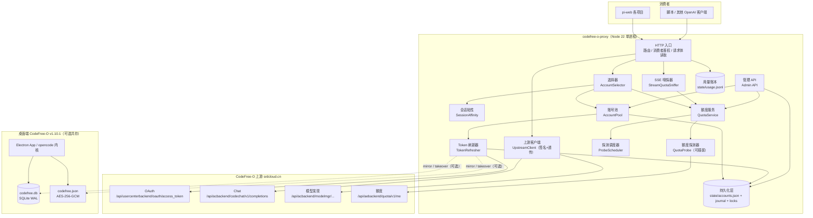
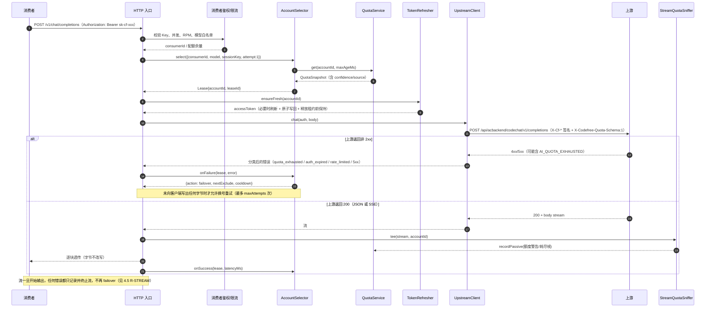
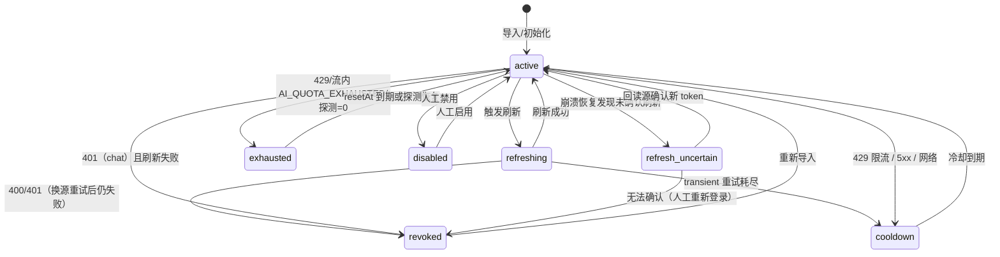
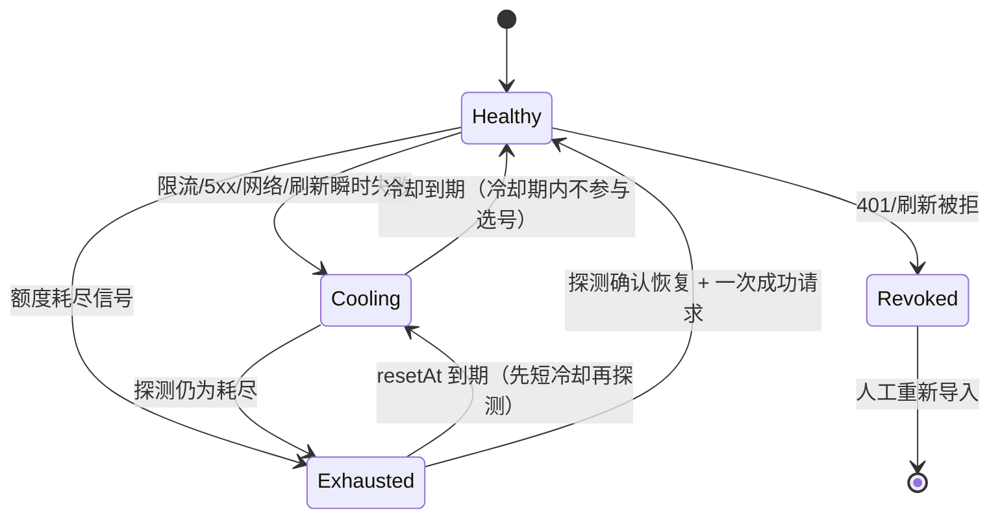
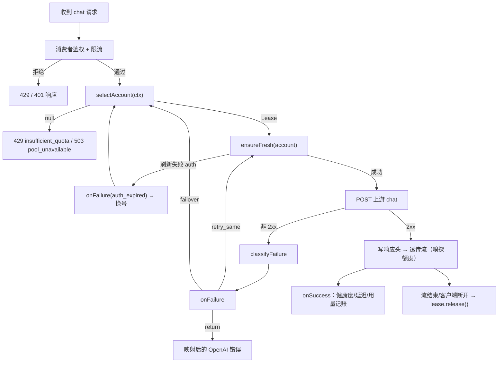

# CodeFree-O 多账号账号池代理设计方案

| 项目 | 内容 |
|------|------|
| 文档编号 | CFO-POOL-DESIGN-001 |
| 版本 | v1.0（评审稿） |
| 日期 | 2026-11-10 |
| 作者 | pool-architect（架构设计） |
| 适用读者 | 代理实现工程师、运维、CodeFree-O 桌面端维护者 |
| 设计对象 | `<repo>`（Node 22 单文件代理 `server.mjs`）→ 多账号账号池代理 |
| 上游版本 | CodeFree-O Desktop v1.10.1（opencode-based Electron）与 CLI 1.7.0 协议并存 |
| 交付性质 | **设计文档（仅文档，不改动任何代码）** |
| 修订 | v1.1（2026-11-10 10:40）：依据 `docs/recon-local-runtime.md`（runtime-recon）实测结果对账，修正"App 未登录/DB 承载登录态"的误判，补充 sidecar 路线与 `codefree/auth/*` 能力，见 0.2 的 K6/K7/K9/K10、1.7、2.2.2、2.2.5、3.1、8.1.1 |

> **证据标注约定**：本文所有关键结论均标注证据等级，避免把推测当成事实。
>
> - **【E1】已确认**：本机静态逆向（`app.asar` 字符串/代码片段）或本机文件/数据库实测直接得到。
> - **【E2】有间接证据**：逆向片段或运行日志强烈支持，但缺少端到端实测。
> - **【E3】待验证假设**：设计所依赖、必须由 REA 分析或实测确认的开放项（见第 8 章 OQ 清单）。
>
> 本文引用的逆向证据均来自本机 `%USERPROFILE%\AppData\Local\Programs\codefree-desktop\resources\app.asar`（121,292,590 字节，构建时间 2026-11-03）与仓库现有 `server.mjs`/`README.md`，证据索引见附录 D。

---

## 0. 摘要

### 0.1 设计目标

将当前"单账号、单消费者、无额度感知"的 CodeFree-O OpenAI 兼容代理，演进为**多账号共享池代理**：

1. **多账号**：N 个 CodeFree-O 账号（凭据）组成池，统一对外提供 `/v1/*` 服务；
2. **自动选号**：按剩余额度、健康度、并发负载、会话粘性自动选择账号；
3. **自动切换**：额度耗尽 / 鉴权过期 / 上游 5xx / 限流时自动 failover，对消费者透明；
4. **多消费者**：多个调用方（pi-web 项目、脚本、其他 OpenAI 客户端）用各自 API Key 接入，具备独立配额与限流；
5. **不破坏桌面端**：绝不损坏 CodeFree-O 桌面 App 自身的登录态（refresh token 轮换是单次性的，见 2.3）。

### 0.2 关键结论（TL;DR）

| # | 结论 | 证据 | 对设计的影响 |
|---|------|------|--------------|
| K1 | **1.10.1 与 1.7.0 的鉴权协议基本同构**：`tokenPath=/api/usercenterbackend/oauth/access_token`、`grant_type=refresh_x_cf_token`、`client_id=<REDACTED_CLIENT_ID>`、生产 `client_secret=<REDACTED_CLIENT_SECRET>`、签名密钥 `<REDACTED_SIGNING_SECRET>`、签名串 `METHOD\nappId\ntimestamp\nnonce`、`X-Cf-Token/userId/projectId` 头——均未变化。 | 【E1】 | 现有 `server.mjs` 的鉴权注入与签名逻辑可**原样复用**，P0 阶段风险低。只需把 `VERSION` 从 `1.7.0` 升级到 `1.10.1`（模型发现路径含版本号）。 |
| K2 | **额度可主动查询**：1.10.1 内置 `GET /api/aebackend/quota/v1/me`（"Get my token quota"）与 `POST /api/aebackend/quota/v1/me/upgrade`，并有 400/401/409/503 的明确错误模型。 | 【E1】路径与错误模型；【E3】响应体结构 | "额度感知选号"从"只能靠 429 猜测"升级为"可主动探测 + 被动校正"，是本方案成立的关键。 |
| K3 | **额度是双周期模型**：`5H`（5 小时）与 `7D`（7 天）两个窗口；错误体含 `period/periods/exhaustedMask/periodDetails/resetAt/retryAt/quotaWorkTime`，`exhaustedMask` 位 1=`5H`、位 2=`7D`。额度可能只在"工作时间"（`quotaWorkTime`）内生效，且周期"从首次使用开始"。 | 【E1】解析逻辑；【E3】字段语义细节 | 选号不能只看"剩余百分比"，必须按周期建模 `resetAt`，冷却时间取"最早恢复周期"。 |
| K4 | **额度耗尽可能出现在 HTTP 200 的 SSE 流内部**：App 在流处理层解析帧，命中 `AI_QUOTA_EXHAUSTED` 后把 assistant 消息标记为错误；流内还有 `codefree.quota.warning`（含 `usagePercent/thresholdPercent`）事件。 | 【E1】App 代码；【E3】上游 SSE 帧的确切形状 | 代理必须实现 **SSE 额度嗅探器**（tee 流、解析 `data:` 帧），否则会漏掉最主要的额度信号。 |
| K5 | **桌面 App 自身也维护认证缓存并会刷新**：`codefree.json`（version 2，`encryptedRefreshCfToken` AES-256-GCM，key=`codefree-o-refresh-token-local-encryption-key-v1`），刷新失败会重读文件、若 refresh token 已被他人轮换则用新值重试（`refreshWithStoredRetry`），并带 `revision` 版本守卫。 | 【E1】 | 代理与 App 共用同一账号时存在**双写者竞争**；必须规定唯一刷新者与写回策略（2.7 共存规则）。 |
| K6 | **App 支持"环境变量托管认证"**：设置 `SRDCLOUD_CF_ACCESS_TOKEN/SRDCLOUD_USERID/SRDCLOUD_PROJECTID/SRDCLOUD_BASE_URL`（或 `~/.srdcloud_env`）后，App 进入 `environment` 模式，不再自行刷新；该模式下请求头为普通头 `accessToken/userId/projectId`，**删除 `x-cf-*` 签名头与 Authorization**，且目标必须与 `SRDCLOUD_BASE_URL` 同源。 | 【E1】 | 说明上游可能存在"无签名、仅 token 头"的鉴权旁路（OQ-4 需实测）；但 token 2 小时过期且注入是启动时静态的，仅作测试/兜底方案（C-8）。 |
| K7 | **本机 App 当前已登录**（recon 实测 `GET /codefree/auth/status` → `authenticated=true, userId=10001, cfToken expiresAt=2026-11-10T10:30:37+08`）。**SQLite 的 `account/account_state/control_account` 表 0 行且不是 CodeFree 登录态来源**——它们是 opencode 通用多账号/组织能力（`switchableOrgCount=0`）。真实凭据只在 `~/.codefree-o/.local/share/codefree.json`（AES-GCM 加密 refresh token）+ 主进程内存（cfToken 不落盘）。 | 【E1】recon §3/§8/§10 | ① P0 可直接用现有登录态跑通；② **"从 DB 自动导入"降级为可选/未来兼容能力**，主凭据来源是 `codefree.json` 与 sidecar；③ OQ-3/OQ-8/OQ-10 需按此修正。 |
| K8 | **refresh token 是单次性轮换（rotation）**：每次刷新返回新 refresh token，旧值失效。代理、App、其他工具（如旧版 mgmcp）都可能刷新。 | 【E1】旧代理注释与 App 代码一致；recon §8.4 | 这是**全方案最大的工程风险**：并发刷新会导致一方拿到 `invalid_grant` 且不可恢复，只能人工重新登录。必须"单写者 + single-flight + 乐观锁 + 多源回读重试"（2.3/7.5）。 |
| K9 | **桌面 App 正在主动刷新并轮换 refresh token**：recon 三次采样显示 `codefree.json` 的 `refreshCfTokenExpiresAt` 与 mtime 持续前移（10:01 → 10:14 → 10:15:49），即 App 每约 2 小时刷新一次、每次轮换并滚动 7 天。 | 【E1】recon §3.3 | 代理与 App 共用同一 `codefree.json` 时，**冲突是现实风险而非理论风险**；`mirror` 模式必须"刷新前重读 + 写回后立即落盘"，且不能保证 100% 无冲突。默认 `isolated` 更稳妥。 |
| K10 | **本地 sidecar 提供 CodeFree 专用接口**：`GET /codefree/auth/status`（返回 `authenticated/baseUrl/userId/clientId/expiresAt/mode/managedBy/canLogin/canLogout/login{state,authUrl}`）、`POST /codefree/auth/login`（启动浏览器 OAuth+PKCE，返回 `authUrl`）、`POST /codefree/auth/logout`。认证为 HTTP Basic，用户名固定 `codefree`，口令为每次启动随机 UUID、仅主进程内存。 | 【E1】recon §5/§6.2 | ① 可作为单账号健康检查/登录辅助（S11/S12）；② 口令每次启动变化，**不适合作为长期凭据来源**；③ 为 OQ-11（无头登录）提供现实路径。 |

### 0.3 核心设计决策（供评审拍板）

| 决策 | 选择 | 理由 | 备选与否决原因 |
|------|------|------|----------------|
| D1 账号归属 | **池内账号默认"代理专属"**（`isolated` 模式）：账号由代理独占刷新；桌面 App 账号默认只读导入、不共用 | 轮换单次性 → 一个 refresh token 只能有一个刷新者；共用必然产生竞争 | "全部共用 App 账号"：无法保证 App 不刷新，风险不可控 |
| D2 写回策略 | 分三档：`isolated`（默认，只写代理 state）/ `mirror`（额外写回 App DB/JSON，带乐观锁）/ `takeover`（代理唯一刷新者，App 只读） | 按部署形态渐进；默认最安全 | 直接改 App DB 为默认：写坏 App 登录态代价过高 |
| D3 额度来源 | **主动探测 `quota/v1/me` + 被动信号（429 错误体、SSE 帧、响应头）+ 本地估算**，三级降级，每条信号带 `confidence` | 响应结构未知，不能把宝押在单一端点 | 只靠 429：永远慢一拍，且流内错误会漏判 |
| D4 选号算法 | **headroom（额度余量）加权评分 + 粘性会话 + 冷却状态机 + 每账号并发租约**，确定性 tie-break | 简单、可解释、可单测；避免复杂优化器 | 纯轮询：不看额度，池子小时频繁耗尽；纯最少连接：忽略额度 |
| D5 进程模型 | **单进程（Node 22）事件循环**，账号级互斥 + 文件锁防多进程；不做集群 | 规模（<20 账号、<50 消费者）单进程足够；多进程会放大轮换竞争 | 多 worker：共享 SQLite/文件状态复杂度与风险不成比例 |
| D6 配置 | **JSON（`config.json`）+ 环境变量覆盖**，不引入 YAML 依赖 | 仓库零依赖现状；Node 原生 JSON | YAML：需 `js-yaml`，收益低 |
| D7 管理面 | 新增 `/admin/*`，默认仅 `127.0.0.1` + `X-Admin-Token`；消费者走 `Authorization: Bearer sk-cf-*` | 与 OpenAI 兼容面隔离；本地运维足够 | 复用 `/v1` 路径：会污染兼容面 |

---

## 1. 总体架构

### 1.1 设计目标与非目标

| 类别 | 条目 |
|------|------|
| **目标** | ① 多账号池化与自动选号；② 额度/健康感知与自动切换；③ 多消费者 API Key 接入与限流；④ 与桌面 App 安全共存；⑤ 保持 OpenAI `/v1` 兼容面不变；⑥ 可观测（账号/额度/用量/健康）；⑦ 单账号模式退化为等价行为（向后兼容） |
| **非目标** | ① 不做跨机器分布式池（单机单进程）；② 不做账号自动注册/自动登录（登录仍需人工或显式 CLI 流程，见 OQ-11）；③ 不做计费/结算；④ 不改桌面 App 本体；⑤ 不做模型能力路由（按模型挑账号仅做"不可用排除"）；⑥ 不代理非 chat 类业务（MCP、market 等） |
| **约束** | 单进程 Node 22（原生 fetch）；Windows 10/11 主机；上游为 `https://www.srdcloud.cn`；refresh token 轮换不可逆；桌面 App 可能同时运行 |

### 1.2 组件总览



### 1.3 组件职责与接口边界

| 组件 | 职责 | 主要接口（详见附录 A） | 不做什么 |
|------|------|------------------------|----------|
| **HTTP 入口** | 路由、消费者鉴权、请求体读取/大小限制、错误映射、SSE 透传 | `handleChat/handleModels/handleAdmin` | 不做选号决策 |
| **AccountPool** | 账号记录的唯一权威内存视图；增删改查；启用/禁用；导入；状态迁移；对外快照（脱敏） | `list/get/add/remove/setEnabled/markState/snapshot` | 不发网络请求 |
| **TokenRefresher** | 按账号刷新 access token；single-flight 互斥；轮换写回；吊销判定；journal | `ensureFresh(accountId)/refresh(accountId)` | 不决定用哪个账号 |
| **QuotaService** | 维护每账号 `QuotaSnapshot`；合并主动/被动信号；估算；对外查询（带新鲜度） | `get(accountId,{maxAgeMs,force})/recordPassive/recordProbe` | 不直接选号 |
| **QuotaProbe（可插拔）** | 单账号额度探测的一个信号源 | `probe(account, ctx)` | 不写状态（结果交给 QuotaService） |
| **ProbeScheduler** | 主动探测排程：热/温/冷分层、抖动、退避、并发预算、QPS 限速 | `start/stop/schedule(accountId,tier)/tick()` | 不解析响应 |
| **AccountSelector** | 候选过滤 → 评分 → 排序 → 租约；粘性；失败处理（冷却、状态、failover 决策） | `select(ctx)/onFailure(lease,err)/onSuccess(lease,info)` | 不发 HTTP |
| **SessionAffinity** | 消费者/会话 → 账号的粘性映射（TTL、失效） | `get/set/invalidate/sweep` | 不持久化敏感信息 |
| **UpstreamClient** | 组装签名头与业务头、发请求、错误分类、返回响应 | `chat(auth,body)/models(auth)/quota(auth)` | 不做重试编排（由入口层统一） |
| **StreamQuotaSniffer** | tee SSE 流、解析帧、识别额度信号/警告、透传不改字节 | `createTap(accountId)/observe(line)` | 不改写流内容 |
| **Admin API** | 账号/额度/用量/健康查询；配置热加载；手动刷新/禁用 | 见 5.3 | 不做批量写账号（除导入） |
| **Persistence** | 状态文件原子写、journal、锁、备份、启动恢复 | `load/saveAtomic/appendJournal/recover/lock` | 不存日志明文 token |

### 1.4 一次 chat 请求的数据流



### 1.5 代码结构建议（不强制，但推荐）

当前 `server.mjs` 为单文件 420 行，直接堆叠多账号逻辑会失控。建议**保持 `server.mjs` 为唯一入口**，内部按模块拆分（Node ESM，无需构建）：

```
研发云proxy/
├─ server.mjs                 # 入口：配置加载、HTTP 路由、优雅退出（保留文件名与启动方式）
├─ config.json                # 运行配置（gitignore）
├─ config.example.json        # 配置样例（提交）
├─ src/
│  ├─ config.mjs              # 配置加载/校验/环境变量覆盖/热加载
│  ├─ log.mjs                 # 结构化日志 + token 脱敏
│  ├─ pool/
│  │  ├─ account-pool.mjs     # AccountPool
│  │  ├─ account-model.mjs    # AccountRecord 定义、状态枚举、指纹
│  │  ├─ refresher.mjs        # TokenRefresher（single-flight + 轮换）
│  │  ├─ writeback.mjs        # StateWriteBack / SqliteWriteBack / AuthFileWriteBack
│  │  ├─ sqlite-import.mjs    # 只读导入（快照复制 + 只读连接）
│  │  └─ authfile.mjs         # codefree.json v2 加解密（复用现有 AES-GCM 逻辑）
│  ├─ quota/
│  │  ├─ quota-service.mjs    # QuotaService（快照合并/新鲜度/估算）
│  │  ├─ probe.mjs            # QuotaProbe 基类与 Composite
│  │  ├─ probes/
│  │  │  ├─ usage-endpoint.mjs
│  │  │  ├─ http-error.mjs
│  │  │  ├─ stream-signal.mjs
│  │  │  └─ header.mjs
│  │  └─ scheduler.mjs        # ProbeScheduler
│  ├─ select/
│  │  ├─ selector.mjs         # AccountSelector
│  │  ├─ affinity.mjs         # SessionAffinity
│  │  └─ cooldown.mjs         # 冷却状态机
│  ├─ upstream/
│  │  ├─ client.mjs           # UpstreamClient（签名、头、错误分类）
│  │  ├─ signer.mjs           # X-Cf-* HMAC
│  │  ├─ sniffer.mjs          # SSE 额度嗅探
│  │  └─ errors.mjs           # 错误分类与 OpenAI 映射
│  ├─ admin/
│  │  ├─ routes.mjs           # /admin/*
│  │  └─ auth.mjs             # admin token 校验
│  ├─ consumers/
│  │  ├─ registry.mjs         # API Key 注册表（哈希存储）
│  │  └─ limiter.mjs          # 每 Key 并发/RPM/配额
│  ├─ state/
│  │  ├─ store.mjs            # 原子写/读/恢复
│  │  ├─ journal.mjs          # 追加日志
│  │  └─ locks.mjs            # 文件锁（Windows 兼容）
│  └─ usage/
│     └─ ledger.mjs           # usage.jsonl 记账与轮转
├─ state/                     # 运行态（gitignore）
├─ docs/
│  ├─ design-multi-account.md # 本文档
│  └─ recon-local-runtime.md  # runtime-recon 产出的运行时侦察报告（若存在）
├─ check-token-expiry.py      # 保留：P1 起改为读 state/accounts.json，兼容旧 .auth-state.json
└─ test/
   ├─ unit/                   # 选择器/额度合并/刷新互斥
   ├─ integration/            # 假上游（http server）端到端
   └─ soak/                   # 长稳压测脚本
```

> 约束：**不得**修改仓库现有 `README.md`、`server.mjs` 以外文件；本设计阶段只产出本文档。上述结构由 Lead 在实现阶段落地。

### 1.6 部署拓扑（Windows）

| 形态 | 说明 | 适用阶段 |
|------|------|----------|
| 前台调试 | `node server.mjs`（Node 22，需原生 fetch） | P0/P1 开发 |
| Windows 服务 | 用 `nssm` 或"计划任务（开机启动、失败重启）"包装；工作目录固定，日志重定向到 `state/logs/` | P2+ 常驻 |
| 单账号兼容 | `pool.size===1` 且未配置 consumers 时，行为与现状等价（见 5.4） | 迁移期 |

### 1.7 接入路线选型（A/B/C）

runtime-recon 实测确认了三条可行的上游接入路线（详见 `docs/recon-local-runtime.md` §11）。本设计**以路线 C 为主**，A/B 作为可选补充：

| 路线 | 做法 | 优点 | 缺点/风险 | 本设计中的定位 |
|------|------|------|------------|----------------|
| **A. 复用桌面 sidecar** | `Authorization: Basic base64("codefree:<随机UUID>")` 调用 `127.0.0.1:<port>` 的 opencode Server（`/api/session/*`、`/event` 等） | 零凭据复制、不触碰 refresh token 轮换、模型/Provider 现成 | 口令每次启动随机（需内存扫描恢复，属非持久通道）；端口动态；只能代表 App 当前登录的那一个账号，**无法多账号池化** | **不作为池的主通道**；可选作为"单账号健康检查/额度兜底探测"（S11/S12） |
| **B. 独立托管 opencode Server** | 用普通 Node 导入 `out/main/chunks/node-CC-GAWt2.js` 导出的 `Server`，`Server.listen({port,hostname,username,password})`，隔离 HOME/XDG | 口令/端口自定、可与桌面端并存、功能最全（会话/工具/事件） | 依赖 33MB bundle 与 3 个原生模块（junction）；独立 home 下无登录态，需 `OPENCODE_CODEFREE_AUTH_FILE` 指向凭据副本 → 又回到轮换问题 | 备选（若需要完整 opencode 能力）；P4 后再评估 |
| **C. 直连上游 `www.srdcloud.cn`** | 本地解密 refresh token → 刷新 cfToken → 构造 `X-Cf-*` 签名头直连业务 API | 与现有 `server.mjs` 同构、可完全控制多账号与选号、无额外进程 | 需自行处理 refresh token 轮换竞争；chat 真实路径需 P0 实测（OQ-5） | **主路线**（本文档 1~8 章均按 C 设计） |

**结论**：多账号池的本质是"多份 refresh token 各自刷新"，路线 A 只能服务单账号、路线 B 会把"共享 codefree.json"问题原样带进来，因此 **C 是唯一能支撑池化的路线**；A/B 仅作辅助（健康检查、额度兜底、功能兜底）。

---

## 2. 凭证生命周期

### 2.1 账号数据模型（AccountRecord）

```jsonc
{
  "id": "acc_3f9c1a2b",              // 代理内部稳定 ID：acc_ + sha256(baseUrl|userId|email)[0..8]
  "email": "user@example.com",
  "baseUrl": "https://www.srdcloud.cn",
  "userId": "10001",                // X-Cf 头 userId
  "clientId": "<REDACTED_CLIENT_ID>",
  "orgId": null,                     // 可选：account_state.active_org_id；额度/权限可能按组织
  "accessToken": "<cfToken>",        // 敏感：内存明文，落盘加密
  "accessTokenExpiresAt": 1794200000000,  // epoch ms
  "refreshToken": "<refresh>",       // 敏感：内存明文，落盘加密；轮换单次性
  "refreshTokenExpiresAt": 1794880837266, // epoch ms
  "tokenKind": "cf",                 // cf（x_cf_token）| oauth（access_token 形态）
  "status": "active",                // 状态机见 2.3.4
  "enabled": true,
  "source": "config",                // config | sqlite-import | authfile-import | admin
  "writeBack": "isolated",           // isolated | mirror | takeover（见 2.4）
  "revision": 7,                     // 每次成功刷新 +1，写回乐观锁依据
  "refreshGeneration": 7,            // 同 revision，用于 journal 对账
  "lastRefreshAt": 1794200000000,
  "lastRefreshError": null,
  "refreshFailCount": 0,
  "lastUsedAt": 1794200000000,
  "lastSuccessAt": 1794200000000,
  "ewmaLatencyMs": 1850,
  "maxConcurrent": 3,                // 每账号并发上限（配置可覆盖）
  "priority": 0,                     // 池内优先级（高者优先被保留）
  "tags": ["pool-a"],
  "modelDenylist": {},               // { "模型名": 失效时间戳 } —— 该账号对该模型不可用
  "createdAt": 1794100000000,
  "updatedAt": 1794200000000
}
```

**运行时字段（不落盘）**：`inUse`（当前并发数）、`leaseQueue`、`healthScore`、`quotaSnapshot`、`cooldownUntil`、`refreshPromise`。

**状态枚举（`status`）**：

| 状态 | 含义 | 进入条件 | 退出条件 |
|------|------|----------|----------|
| `active` | 可用 | 初始化/刷新成功/冷却结束 | 任何失败迁移 |
| `refreshing` | 刷新中（瞬时） | `refresh()` 开始 | 刷新成功/失败 |
| `exhausted` | 额度耗尽 | 429/流内 `AI_QUOTA_EXHAUSTED`/探测为 0 | `resetAt` 到期或探测恢复 |
| `cooldown` | 临时冷却 | 限流/5xx/网络错误 | 冷却计时结束 |
| `revoked` | 凭据失效 | refresh 400/401、401 且刷新失败 | 人工重新导入 |
| `refresh_uncertain` | 刷新结果不确定（崩溃恢复） | journal 显示"已发起未确认" | 回读源确认/人工处理 |
| `disabled` | 人工禁用 | Admin 操作 | 人工启用 |

> 设计原则：**状态只由 `TokenRefresher` / `AccountSelector` 的单一入口迁移**，避免多处写状态导致不一致（`AccountPool.transition(id, from, to, reason)` 校验前置状态）。

### 2.2 账号导入

#### 2.2.1 四种来源

| 来源 | 触发 | 数据 | 默认 `writeBack` | 说明 |
|------|------|------|------------------|------|
| **config.json `accounts[]`** | 启动加载 | 明文/引用式凭据 | `isolated` | 手工维护，适合少量稳定账号 |
| **App SQLite 导入（可选/低优先）** | 启动时或 `POST /admin/accounts/import` | `account` / `control_account` 表 | `mirror`（可配） | **recon 实证：这两张表不承载 CodeFree 登录态**（登录态存在时仍 0 行），属 opencode 通用多账号/组织能力；保留为"未来兼容/清单"能力，**不作为主凭据来源**（见 2.2.2 警告） |
| **`codefree.json` 导入** | 启动时或 Admin | v2 加密 refresh token | `isolated` | 兼容 1.7.0 CLI 与 1.10.x 桌面端（同一 v2 格式）；**注意这是 App 正在使用的活凭据**（K7/K9），共用时必须按 2.2.3 的风险处置 |
| **环境变量托管** | 启动时检测 | `SRDCLOUD_CF_ACCESS_TOKEN` 等 | `isolated`（只读） | 仅当 4 个变量齐全；用于测试/托管，token 短命 |

**幂等键**：`sha256(baseUrl + "|" + userId)`，缺失 userId 时退化为 `sha256(baseUrl + "|" + email)`。重复导入**更新**而非新增；若 refresh token 不同则以"更新的 `time_updated`"为准，并在日志中记录来源变更。

#### 2.2.2 从 App SQLite 导入（只读，安全流程）

> ⚠️ **重要修正（v1.1，依据 recon §3/§12）**：本机实测 `account`/`account_state`/`control_account` 三表在**已登录状态下仍为 0 行**，且 recon 判定它们属 opencode 通用多账号/组织切换能力（`switchableOrgCount=0`、`orgs=[]`），**不是 CodeFree 登录态来源**。因此本节的导入能力：
>
> 1. **不是主路径**——主路径是 `codefree.json` 导入（2.2.3）与 sidecar 登录（2.2.5）；
> 2. 保留为"若未来 App 启用该多账号表"的前向兼容能力，以及账号清单/邮箱等元数据来源；
> 3. 在 DB 为空时必须**静默跳过**（返回 `skipped`，不报错、不告警升级）。

**关键约束**：App 使用 WAL 模式且可能正在运行；直接以读写方式打开会引入锁竞争，且读到"主库旧页 + 未合并 WAL"的不一致快照。**必须复制三件套后离线解析**（与本次侦察做法一致，【E1】已验证可行）：

```
步骤：
1) 复制 codefree.db、codefree.db-wal、codefree.db-shm 到 state/imports/<ts>/（同一快照时刻，顺序：shm → wal → db，或整体短暂重试）
2) 以只读连接打开副本：file:<copy>?mode=ro（不要用 immutable=1，否则会忽略 WAL）
3) 读取 account / control_account / account_state；绝不写
4) 解析后按幂等键 upsert 到 AccountPool
5) 记录 import 结果：{imported, updated, skipped, warnings[]}，并把副本保留 24h 便于审计后清理
```

**SQL（只读）**：

```sql
-- 主账号表：多账号登录态
SELECT id, email, url, access_token, refresh_token, token_expiry, time_created, time_updated
FROM account;

-- 控制面账号（可能用于本地服务/管理能力；active=1 表示当前控制账号）
SELECT email, url, access_token, refresh_token, token_expiry, active, time_created, time_updated
FROM control_account;

-- 当前激活指针：仅用于"标记 preferred"，绝不修改
SELECT id, active_account_id, active_org_id FROM account_state;
```

**字段映射与容错**：

| DB 列 | AccountRecord | 处理规则 |
|-------|---------------|----------|
| `id` | `sourceRef.dbId` | 仅作溯源，不用作代理 ID |
| `email` | `email` | 去空格；缺失则用 `user:<userId>` 占位 |
| `url` | `baseUrl` | 去尾部 `/`；校验 https 且域名在允许列表 |
| `access_token` | `accessToken` | 原样；`tokenKind` 由格式推断（见 2.5） |
| `refresh_token` | `refreshToken` | 原样；若为空/占位则跳过并告警 |
| `token_expiry` | `accessTokenExpiresAt` | **单位自适应**：`> 1e12` 视为 ms；`1e9 ~ 1e12` 视为秒并 ×1000；`0/null` 视为未知（标记 `expiryUnknown`）【E3 待实测】 |
| `time_updated` | `sourceUpdatedAt` | 用于冲突判定（较新者胜） |
| `active`（control_account） | `controlActive` | 仅记录，不参与选号 |

> **OQ-3（v1.1 已降级）**：recon 实证 DB 的 `account` 等表**不承载 CodeFree 登录态**（已登录时仍 0 行，见 8.1.1），因此本节的字段映射仅作为"未来 App 启用该表"的前向兼容。真正的凭据来源是 `codefree.json`（2.2.3）与 sidecar 登录（2.2.5）；`token_expiry` 单位问题在导入侧仍用"量级启发式 + 运行时校准"兜底。

#### 2.2.3 从旧 `codefree.json` 导入

旧文件格式【E1】（与本机实测一致）：

```json
{
  "version": 2,
  "encryptedRefreshCfToken": "v1:<iv_b64>:<ct_b64>:<tag_b64>",
  "refreshCfTokenExpiresAt": 1794880837266,
  "userId": "10001",
  "baseUrlSnapshot": "https://www.srdcloud.cn"
}
```

解密复用现有 `server.mjs` 的 `decryptRefreshToken`（AES-256-GCM，key = `SHA256("codefree-o-refresh-token-local-encryption-key-v1")`，12 字节 IV，tag 16 字节）。1.10.1 的 `persistable()` 生成格式完全一致【E1】。

导入后 `accessToken = null`、`tokenKind = "cf"`、`status = active`（待首次刷新）。**首次使用前必须刷新一次**以获得可用 access token。

> ⚠️ **共用风险（v1.1）**：该文件正是桌面 App 当前正在使用的凭据（K7/K9，App 每 ~2h 刷新并轮换）。若代理直接导入并刷新，会与 App 形成双写者竞争。两种安全用法：
> ① **快照导入 + App 退出该账号**（推荐）：导入后让 App 登出/换号，代理独占刷新；
> ② **mirror 写回**：代理刷新后立即原子写回该文件（保留未知字段 + 备份），依赖 App 的 `refreshWithStoredRetry` 在失败时重读新 token（仍有极小冲突窗口，见 7.5）。
> 绝不允许"导入后既不写回、App 又继续使用"——这必然导致一方失效。

#### 2.2.4 导入的校验与拒绝规则

| 校验 | 不通过时 |
|------|----------|
| `baseUrl` 为 https 且 host ∈ 白名单（`www.srdcloud.cn`、`test.`、`dev.`） | 拒绝该条，告警 |
| `refreshToken` 非空且长度合理（> 20） | 跳过并告警 |
| `refreshTokenExpiresAt` 未过期（或未知） | 导入但标 `expired`，不参与选号 |
| 同一幂等键不重复 | 按 `time_updated` 较新者覆盖 |
| 数量上限（默认 50） | 拒绝并提示 |

#### 2.2.5 借助桌面 sidecar 的账号登录流程（OQ-11 的现实路径）

recon 已打通 sidecar 的 CodeFree 专用接口（K10）。据此可设计**半自动账号导入流程**（P1+，需人工在浏览器完成授权）：

```
1) 代理/运维调用 sidecar: POST /codefree/auth/logout        （清空 App 当前凭据，若允许）
2) POST /codefree/auth/login  → 返回 { login: { authUrl, state } }
3) 人工在浏览器打开 authUrl，用目标账号完成 OAuth+PKCE（回调到本机 loopback）
4) 轮询 GET /codefree/auth/status 直到 authenticated=true（记录 userId/expiresAt）
5) 读取 ~/.codefree-o/.local/share/codefree.json（v2），解密出 refresh token
6) 以 isolated 模式写入代理 state（该账号由代理独占刷新）
7) 再次 POST /codefree/auth/logout（防止 App 继续刷新同一账号 → 轮换冲突）
8) 记录导入审计：账号邮箱、userId、导入时间、操作人
```

**约束与风险**：

- 步骤 1/7 的 `logout` 是否在服务端吊销凭据**未知**（OQ-11），若会吊销则流程改为"登录后立即读取并保持 App 登录不动"；
- 若 App 继续持有并刷新同一账号，则与代理冲突（K9）→ 导入后必须确认 App 已退出该账号；
- sidecar 口令为随机 UUID（K10），代理若自动化此流程需实现"内存扫描恢复口令"，**仅限本机、且需在运维手册中明确**；生产建议人工执行步骤 1~4 后由代理读文件导入（步骤 5~6 自动化）；
- 若 `/codefree/auth/login` 的 `authUrl` 含 `state`/PKCE 参数，必须原样使用，不得改写。

### 2.3 Token 刷新（核心）

#### 2.3.1 协议细节（与 1.7.0 一致，【E1】1.10.1 未变）

```
POST {baseUrl}/api/usercenterbackend/oauth/access_token
Content-Type: application/x-www-form-urlencoded
Accept: application/json

grant_type=refresh_x_cf_token
client_id=<clientId>
x_cf_refresh_token=<refreshToken>
client_secret=<clientSecret>     // 生产固定值；可用 CODEFREE_CLIENT_SECRET 覆盖
```

**响应归一化**（与 App 的 `normalizeToken` 对齐）：

| 目标字段 | 候选键（按序） | 默认值 |
|----------|----------------|--------|
| `cfToken` | `x_cf_token` → `cf_token` → (`token_type=="cf_token"` 时的 `access_token`) | 无则报错 |
| `refreshCfToken` | `x_cf_refresh_token` → `refresh_token` → `refresh_cf_token` → `cf_token_refresh_token` | 无则报错 |
| `expiresIn` | `x_cf_token_expires_in` → `cf_token_expires_in` → `expires_in` | 7200 秒 |
| `refreshExpiresIn` | `x_cf_refresh_token_expires_in` → `refresh_token_expires_in` → `refresh_cf_token_expires_in` → `cf_token_refresh_token_expires_in` | 604800 秒 |
| `userId` | `user_id` → `uid` → `userId` | 沿用旧值 |

**错误分类**：

| 上游响应 | 分类 | 处理 |
|----------|------|------|
| 400/401（任意 body） | `auth_revoked`（终态） | 账号置 `revoked`；**不重试**；告警；返回 401 `auth_expired` 语义（若池内无可用账号） |
| 408/429/5xx/网络错误 | `transient` | 退避重试（默认 3 次：300/900/2700ms，带抖动） |
| 200 但缺 token 字段 | `protocol_error` | 视为 transient，记录响应摘要（脱敏） |
| 200 正常 | `ok` | 写回 + 状态迁移 |

> 与现有实现差异：旧 `server.mjs` 在 400 时用 body 关键字（`invalid_client`/`invalid_grant`）判定过期；1.10.1 的 App 则把**任何 400/401 都视为 refresh 被拒**【E1】。新设计采用 App 的判定（更保守），同时保留旧关键字用于日志归因。

#### 2.3.2 刷新触发条件

| 触发 | 条件 | 说明 |
|------|------|------|
| 惰性触发 | `accessTokenExpiresAt - now < refreshSkewMs`（默认 **120s**） | 请求前 `ensureFresh` |
| 主动预刷新 | 探测调度器发现 `accessTokenExpiresAt - now < 10min` 且账号为"热" | 避免请求路径上阻塞 |
| 401 反应式 | 上游 chat 返回 401 | 强制刷新一次后重试（同账号），再失败则 failover |
| 管理触发 | `POST /admin/accounts/:id/refresh` | 运维手动 |
| 启动预热 | 进程启动后对 `enabled` 且非 `revoked` 账号并发刷新（限 2 并发） | 避免冷启动首请求排队 |

#### 2.3.3 并发安全：single-flight + 跨进程锁 + 多源回读

```js
// 伪代码：TokenRefresher.refresh()
async refresh(accountId, { reason }) {
  const acc = pool.get(accountId);

  // 1) 进程内 single-flight：同账号并发刷新合并为一次
  if (acc.refreshPromise) return acc.refreshPromise;

  acc.refreshPromise = (async () => {
    // 2) 跨进程互斥（防多实例/外部工具同时刷新）
    const lock = await locks.acquire(`refresh:${accountId}`, { staleMs: 30_000 });
    try {
      // 3) 刷新前回读源：若磁盘/DB 的 refresh token 与内存不同，采用"较新者"
      //    （对应 App 的 refreshWithStoredRetry 行为）
      await reconcileFromSources(acc);            // 见 2.3.5
      if (Date.now() < acc.accessTokenExpiresAt - cfg.refresh.skewMs) return acc; // double-check

      journal.append({ op: "BEGIN_REFRESH", accountId, prevFingerprint: fp(acc.refreshToken), at: now() });
      pool.transition(accountId, "active", "refreshing");

      let lastErr;
      for (let attempt = 0; attempt <= cfg.refresh.maxRetries; attempt++) {
        try {
          const resp = await upstream.refreshToken({
            baseUrl: acc.baseUrl, clientId: acc.clientId,
            refreshToken: acc.refreshToken, clientSecret: cfg.upstream.clientSecret
          });
          const next = normalizeTokenResponse(resp, acc);

          // 4) 先落盘（journal + state），再内存生效：崩溃窗口最小化
          journal.append({ op: "REFRESH_OK", accountId, newFingerprint: fp(next.refreshToken), at: now() });
          await writeback.commit(acc, next, { expectRevision: acc.revision });  // 见 2.4
          pool.applyRefresh(accountId, next);                                   // revision+1
          pool.transition(accountId, "refreshing", "active");
          return acc;
        } catch (e) {
          lastErr = e;
          if (e.kind === "auth_revoked") {
            // 5) 被拒时先回读：可能是别的进程刚轮换过 → 用新 token 重试一次
            const saved = await readSources(acc);
            if (saved && saved.refreshToken !== acc.refreshToken) {
              acc.refreshToken = saved.refreshToken;
              acc.refreshTokenExpiresAt = saved.refreshTokenExpiresAt;
              continue;                          // 只允许一次"换源重试"
            }
            await writeback.onRevoked(acc);      // 可选：清理镜像源中的失效 token
            pool.transition(accountId, "refreshing", "revoked", e.message);
            throw new AuthExpiredError(e.message);
          }
          if (e.kind !== "transient") throw e;
          await sleep(cfg.refresh.backoff[attempt] * jitter());
        }
      }
      pool.transition(accountId, "refreshing", "cooldown", lastErr.message);
      pool.setCooldown(accountId, cfg.selection.cooldown.refreshErrorMs);
      throw lastErr;
    } finally {
      await lock.release();
    }
  })().finally(() => { acc.refreshPromise = null; });

  return acc.refreshPromise;
}
```

**不变式**：

1. 同一账号在**任何时刻最多一个刷新在途**（进程内 promise + 跨进程 lock 双保险）；
2. 刷新结果**先持久化、后内存生效**（崩溃时以磁盘为准，内存可由磁盘重建）；
3. 每次成功刷新 `revision += 1`，写回携带 `expectRevision` 做乐观锁；
4. 被拒（400/401）**最多**做一次"换源重试"（避免用同一个坏 token 反复打上游）；
5. 任何路径都不记录明文 token，只记录 `fp()`（sha256 前 16 hex）。

#### 2.3.4 账号生命周期状态机



#### 2.3.5 多源回读（reconcileFromSources）

按 `writeBack` 模式决定回读源优先级：

| 模式 | 回读源（按序） | 冲突判定 |
|------|----------------|----------|
| `isolated` | 仅代理 `state/accounts.json` | 无冲突（代理独占） |
| `mirror` | App DB → App `codefree.json` → 代理 state | 取 `time_updated/expiry` 较新者；若 token 不同且无法判定 → 以代理 state 为准并告警（说明存在外部写者） |
| `takeover` | 代理 state（App 侧只读或不刷新） | 以代理 state 为准 |

**回读触发点**：刷新前（reconcile）、刷新被拒后（换源重试）、崩溃恢复（journal 对账）、Admin 手动触发。

### 2.4 原子写回

#### 2.4.1 写回目标与优先级

| 层 | 目标 | 何时写 | 原子性手段 |
|----|------|--------|------------|
| **L1 代理状态（权威）** | `state/accounts.json` + `state/accounts.journal.jsonl` | 每次刷新成功 | 临时文件 + `fsync` + `rename`（同目录）；journal 追加 + `fsync` |
| **L2 App SQLite（可选）** | `codefree.db` 的 `account`/`control_account` | `mirror`/`takeover` 模式 | `BEGIN IMMEDIATE` + 乐观锁 `WHERE refresh_token = ?` + `busy_timeout=5000` |
| **L3 App 认证文件（可选）** | `~/.codefree-o/.local/share/codefree.json` | `mirror`/`takeover` 模式 | 读-改-写 + 备份一次 + 临时文件 rename + `mode 0600` |

> **默认只写 L1**。L2/L3 是"共用账号"场景的可选项，且必须由配置显式开启（`writeBack: "mirror"`），因为写坏 App 登录态的代价远高于收益。

#### 2.4.2 L1：代理状态文件原子写

```js
// state/store.mjs
async function saveAtomic(filePath, obj, { mode = 0o600 } = {}) {
  const dir = path.dirname(filePath);
  const tmp = path.join(dir, `.${path.basename(filePath)}.${process.pid}.${Date.now()}.tmp`);
  const fd = await fs.open(tmp, "w", mode);
  try {
    await fd.writeFile(JSON.stringify(obj, null, 2), "utf8");
    await fd.sync();                       // 关键：落盘后再 rename
  } finally { await fd.close(); }
  await fs.rename(tmp, filePath);          // Windows 同卷 rename 原子（覆盖已存在文件需先 unlink 或使用 MoveFileEx 语义）
  // Windows 注意：Node 的 rename 对已存在目标默认覆盖（libuv 使用 MoveFileExW + REPLACE_EXISTING），可用；
  // 若遇到 EPERM（杀软/索引占用），重试 3 次（50/200/500ms），最终失败则保留 .tmp 并在启动恢复时采纳。
}
```

`state/accounts.json` 结构：

```jsonc
{
  "schemaVersion": 1,
  "savedAt": 1794200000000,
  "accounts": [
    {
      "id": "acc_3f9c1a2b",
      "email": "user@example.com",
      "baseUrl": "https://www.srdcloud.cn",
      "userId": "10001",
      "clientId": "<REDACTED_CLIENT_ID>",
      "orgId": null,
      "tokenKind": "cf",
      "status": "active",
      "enabled": true,
      "source": "config",
      "writeBack": "isolated",
      "revision": 7,
      "accessTokenExpiresAt": 1794200000000,
      "refreshTokenExpiresAt": 1794880837266,
      "enc": {                                  // 敏感字段单独加密，见 6.3
        "alg": "aes-256-gcm",
        "kid": "local-v1",
        "iv": "<b64>", "ct": "<b64>", "tag": "<b64>"
      },
      "lastRefreshAt": 1794200000000,
      "lastSuccessAt": 1794200000000,
      "createdAt": 1794100000000,
      "updatedAt": 1794200000000
    }
  ]
}
```

> `accessToken` 与 `refreshToken` **不落在明文字段**，统一放进 `enc`（加密后的 `{accessToken, refreshToken}` JSON）。内存中解密后使用。

#### 2.4.3 L2：App SQLite 写回（mirror/takeover，谨慎）

```sql
-- 事务前：PRAGMA busy_timeout = 5000;（连接级）
BEGIN IMMEDIATE;
UPDATE account
   SET access_token = ?, refresh_token = ?, token_expiry = ?, time_updated = ?
 WHERE id = ? AND refresh_token = ?;      -- 乐观锁：旧 refresh token 必须匹配
-- changes() === 1 → 成功；0 → 检测到并发写者（App 或另一实例），回滚并告警
COMMIT;
```

**规则**：

1. **绝不在事务内做网络 I/O**：先刷新（网络），再开短事务写库；
2. `BEGIN IMMEDIATE` 立即取写锁，避免升级锁死锁；失败按 `SQLITE_BUSY` 指数退避（50/150/450ms，最多 3 次）；
3. 若 `changes()==0`：说明 App 已自行轮换 → **放弃写回**，把代理侧新 token 保留在 L1（App 侧旧 token 将失效，日志告警"存在外部刷新者，建议切换 isolated 模式或让 App 退出该账号"）；
4. 写回后不执行 `VACUUM`/`wal_checkpoint`（由 App 自己管理）；连接用完即关；
5. 首次写回前对 DB 做**只读备份**（复制三件套到 `state/backups/`），保留最近 5 份。

#### 2.4.4 L3：App `codefree.json` 写回（mirror/takeover）

沿用现有 `server.mjs` 的 `writeAuthFile` 思路，但增加：

1. **备份一次**（`codefree.json.bak.proxy.<ISO时间>`，与现有行为一致）；
2. **保留未知字段**（读-改-写，不整文件覆盖）；
3. 写入字段：`version: 2`、`encryptedRefreshCfToken`、`refreshCfTokenExpiresAt`、`userId`、`clientId`、`baseUrlSnapshot`；
4. `mode 0o600`（Windows 上以 ACL 收紧代替，见 6.3）；
5. **不写 `cfToken`/`accessToken`**（App 的 `persistable()` 只持久化加密 refresh token【E1】，access token 仅内存）。

### 2.5 过期语义

| 时间字段 | 单位 | 来源 | 判定规则 |
|----------|------|------|----------|
| `accessTokenExpiresAt` | epoch ms | 刷新响应 `expires_in * 1000 + now` | 剩余 < `skewMs`(120s) → 需刷新 |
| `refreshTokenExpiresAt` | epoch ms | 刷新响应 `refresh_token_expires_in * 1000 + now`；导入时来自 DB/JSON | 已过期 → 账号不可用（`revoked`/`expired`），需重新登录 |
| DB `token_expiry` | **待确认**【E3】 | App DB | 量级启发式：`>1e12` ms；`1e9~1e12` 秒；否则未知 |
| `QuotaSnapshot.resetAt/retryAt` | epoch ms（推断） | 额度端点/错误体 | 冷却到期时间；单位需实测（OQ-12） |

**时钟处理**：

- 所有比较使用 `Date.now()`（墙钟）；刷新 TTL 用 `expires_in` 相对量计算，避免依赖上游时钟；
- 对 `resetAt` 做**时钟偏移容忍**：若 `resetAt <= now` 但上游仍报耗尽，按 `now + minCooldown(60s)` 处理；
- 启动时若发现系统时钟跳变（与上次 `savedAt` 偏差 > 5min），强制对全部账号重探测并告警。

**告警**（实现于 `lib/alerts.mjs`，webhook 地址通过环境变量 `CODEFREE_ALERT_WEBHOOK` 配置）：

| 条件 | 事件 | 去重 |
|------|------|------|
| 单账号 401（刷新后仍失败）/ refresh token 失效 / 凭据缺失 | `account_auth_expired` | 状态迁移 + `accountCooldownMs`（默认 6h）提醒 |
| 窗口 `usagePercent` ≥ 服务端 `thresholdPercent`（缺失回退 `alert.quotaWarnPercent`，默认 80%） | `account_quota_warning` | 每账号/窗口/resetAt 一次 |
| 窗口 `status=EXHAUSTED` 或 `usagePercent ≥ 100` | `account_quota_exhausted` | 每账号/窗口/resetAt 一次 |
| `quotaStatus=DEGRADED` 或 `statusReason=CONTROL_DISABLED` | `account_control_disabled` | 每账号/类型 6h |
| 上游 5xx / 网络 / 未知失败 / 限流导致账号冷却 | `account_upstream_error` | 每账号/类型 6h |
| refresh token 剩余 < `refreshExpiryWarnHours`（默认 48h） | `refresh_expiring` | 12h |
| 全池登录失效 / 全池额度耗尽 | `all_auth_expired` / `all_quota_exhausted` | `cooldownMs`（默认 10min） |
| 账号或全池恢复 | `account_*_recovered` / `recovered` | 状态迁移 |

额度告警资格对齐桌面端：仅 `quotaStatus=ACTIVE && statusReason=null && !vip` 参与判定；
`BYPASSED` / `OUTSIDE_WORK_TIME` / `VIP` 不产生额度告警。阈值优先取服务端 `thresholdPercent`。

### 2.6 吊销与失效处理

| 场景 | 检测 | 处理 | 恢复 |
|------|------|------|------|
| refresh token 失效（被轮换/过期/注销） | 刷新 400/401 | 账号 `auth-expired`；从选号候选剔除；告警 | 重新登录后 authFile 更新 → 每 `refresh.authRecoveryMs`（默认 10min）自动对账并强制刷新；或 `POST /admin/accounts/:id/refresh` |
| access token 失效（上游 401） | chat 401 | 强制刷新一次 → 仍 401 则 `auth-expired` | 同上 |
| 账号被禁用/封禁 | 403 或特定业务码 | `disabled`（人工确认后）；不自动恢复 | 人工 |
| 账号额度耗尽 | 429/流内错误/探测 | `exhausted` 到 `resetAt` | 自动（到期探测） |
| 凭据被管理员删除 | Admin | 从池移除；若有粘性会话指向它 → 失效并重新选号 | — |

**安全边界**：任何"删除/禁用"操作都**不删除**代理 state 中的历史记录（标记 `deletedAt` 软删），便于审计；**不触碰** App 的数据库行（除非显式 `takeover` 清理，且需二次确认）。

### 2.7 与桌面 App 的共存规则（强制）

> 本节是"不破坏 App 登录态"的落地约束，实现时逐条对照。

| 编号 | 规则 | 理由 |
|------|------|------|
| **C-1** | 默认 `isolated`：代理**不写** App 的 `codefree.db` 与 `codefree.json`，只读导入副本。 | 避免与 App 的写者竞争（K5/K8） |
| **C-2** | **绝不修改** `account_state` 表（`active_account_id` / `active_org_id`）。 | 该指针是 App 的 UI 状态，改动会让用户困惑/触发 App 重新初始化登录 |
| **C-3** | 读取 App DB 必须**复制三件套后只读**；禁止对 App 库执行 `VACUUM`、`wal_checkpoint`、`REINDEX`、`PRAGMA journal_mode` 变更。 | WAL 一致性 + 避免锁竞争 |
| **C-4** | `mirror` 模式下，代理必须是该账号**唯一刷新者**：启用前要求 App 未激活该账号（或 App 已退出）；写回失败（`changes()==0`）即放弃并告警。 | 轮换单次性，双写者必然有一方失效 |
| **C-5** | `takeover` 模式下，App 只读使用；代理启动时对账号做一次"接管检查"（回读 App 源与代理 state，若不一致则以代理为准并备份）。 | 明确唯一权威 |
| **C-6** | 任何模式下，代理**不删除、不重命名** App 文件；备份只写 `state/backups/`。 | 可回滚 |
| **C-7** | 检测 App 版本（`VERSION`）与认证文件 mtime；App 升级（协议可能变化）或文件被外部修改时告警并暂停 `mirror` 写回。 | 版本适配（见 8.1 OQ-15） |
| **C-8** | 环境变量托管模式（`SRDCLOUD_*` / `~/.srdcloud_env`）仅用于测试/托管：它使 App 进入 `environment` 模式不再刷新（【E1】），但 token 2h 过期且启动时静态注入，长期不可持续。 | 避免误用导致 App 掉线 |

**共用账号的风险矩阵**（供运维决策）：

| 部署形态 | App 是否使用该账号 | 代理写回 | 冲突概率 | 建议 |
|----------|--------------------|----------|----------|------|
| A. 代理专属账号（推荐） | 否 | L1 | 极低 | 默认 |
| B. 共用 + mirror | 否（App 切到别的账号） | L1+L2/L3 | 低 | 需确认 App 不会后台刷新非激活账号（OQ-8） |
| C. 共用 + App 同时使用 | 是 | L1+L2/L3 | **高** | 不建议；仅应急 |
| D. takeover + App 只读 | 是（只读） | L1（+L2/L3） | 中 | 需 App 配合（退出/环境变量托管） |

---

## 3. 额度发现

### 3.1 候选信号清单

| 编号 | 信号 | 来源 | 可得数据 | 证据 | 置信度（建议） | 成本 |
|------|------|------|----------|------|----------------|------|
| **S1** | 额度查询端点 | `GET {baseUrl}/api/aebackend/quota/v1/me`（需 X-Cf-* 签名 + `X-Cf-Token/userId/projectId`） | 周期额度、剩余、重置时间（结构待实测） | 【E1】路径存在（App `QuotaPaths.me`）；【E3】响应结构 | 0.85~0.95 | 1 请求/账号/周期 |
| **S2** | 额度耗尽错误体 | chat 非 2xx 响应 body：`{"code":"AI_QUOTA_EXHAUSTED","periods":[...],"exhaustedMask":n,"periodDetails":[...],"resetAt":...,"retryAt":...,"quotaWorkTime":{...}}` | 精确耗尽周期、恢复时间 | 【E1】App 解析逻辑完整可见 | 0.95 | 被动（免费） |
| **S3** | 流内额度警告/耗尽 | SSE 帧内的 `codefree.quota.warning` / `AI_QUOTA_EXHAUSTED`（App 在流处理层解析） | `usagePercent`、`thresholdPercent`、`exhausted`、`canUpgrade`、`quotaWorkTime`、`level` | 【E1】App 代码；【E3】上游帧确切形状 | 0.9 | 被动（免费） |
| **S4** | 响应头 | chat / quota 响应头中可能的 `x-codefree-quota-*`、`x-ratelimit-*`、`retry-after` | 剩余/上限/重置 | 【E3】未确认是否存在 | 0.5~0.7 | 被动（免费） |
| **S5** | 双周期模型 | `periods` 含 `5H` 与 `7D`；`exhaustedMask` 位 1=`5H`、位 2=`7D` | 周期结构 | 【E1】 | — | — |
| **S6** | 工作时间语义 | `quotaWorkTime: {startTime, endTime, timeZone}`；周期"从首次使用开始"（UI 文案 `notStarted`） | 额度生效窗口 | 【E1】字段存在；【E3】语义 | 0.6 | — |
| **S7** | token 过期 | `accessTokenExpiresAt` / `refreshTokenExpiresAt` | 账号可用性（非额度） | 【E1】 | 1.0 | 本地 |
| **S8** | 模型目录/模型不可用 | `GET /api/acbackend/modelmgr/v1/clients/codefree-o/versions/{VERSION}`；chat 返回模型不存在 | 该账号可用模型集合 | 【E1】端点；【E3】是否按账号/组织裁剪 | 0.7 | 1 请求/账号/小时 |
| **S9** | 本地用量估算 | 代理侧 token 记账（响应 `usage` 字段或字符估算） | 自上次探测以来的消耗量 | 设计推导 | 0.2~0.4（随时间衰减） | 免费 |
| **S10** | 计费/账单端点 | 未发现 | — | 【E3】 | — | — |
| **S11** | sidecar 登录态 | `GET /codefree/auth/status`（Basic 认证） | `authenticated/baseUrl/userId/clientId/expiresAt/mode/managedBy/login{state,authUrl}` | 【E1】recon 实测 | 1.0（仅代表 App 当前账号） | 本地 1 请求 |
| **S12** | sidecar 额度代理 | 若 sidecar 暴露 `/api/aebackend/quota/v1/me`（opencode 本地 API 会代理该路径） | 同 S1（经 App 认证） | 【E2】路径在 App 本地 API 中存在；未实测 | 0.7（受 sidecar 口令限制） | 本地 1 请求 |

> **禁止调用**：`POST /api/aebackend/quota/v1/me/upgrade`（额度升级是**变更类**操作，会改变账号状态，代理不得调用）。

### 3.2 QuotaSnapshot 数据模型

```jsonc
{
  "accountId": "acc_3f9c1a2b",
  "at": 1794200000000,              // 快照采集时刻（epoch ms）
  "state": "ok",                    // ok | exhausted | unknown | error
  "periods": [
    {
      "period": "5H",               // 5H | 7D | 其他（透传）
      "limit": 1000000,             // 可能为 null（未知）
      "used": 420000,
      "remaining": 580000,
      "remainingRatio": 0.58,       // 0..1；未知为 null
      "resetAt": 1794203600000,     // 周期重置时刻（epoch ms）
      "retryAt": 1794203600000,     // 建议重试时刻（通常 = resetAt）
      "exhausted": false,
      "quotaWorkTime": { "startTime": "09:00", "endTime": "18:00", "timeZone": "Asia/Shanghai" },
      "confidence": 0.9
    }
  ],
  "bindingPeriod": "5H",            // 当前最紧的周期（决定 headroom）
  "minRemainingRatio": 0.58,        // 所有周期最小值；unknown → null
  "exhaustedMask": 0,               // 位 1=5H，位 2=7D
  "resetAt": 1794203600000,         // 最早恢复时刻（用于冷却）
  "confidence": 0.9,                // 0..1，快照整体可信度
  "source": "quota-endpoint",       // quota-endpoint | http-error | stream | header | estimate | merged
  "ttlMs": 120000,                  // 建议有效期（超过则视为过期，需重探测或降级）
  "conflict": false,                // 信号冲突标记（例如端点说 ok、错误体说 exhausted）
  "rawSummary": { "code": 0 }       // 脱敏后的原始摘要（不含 token）
}
```

**合并规则（CompositeQuotaProbe）**：

1. **保守优先**：同一周期内，`exhausted=true` 的信号优先于 `ok`；`remainingRatio` 取更小值。
2. **新鲜度优先**：同一来源内，`at` 更新的覆盖旧的；不同来源间按 `confidence × freshness` 加权，但"耗尽"信号在 5 分钟内不可被低置信度 `ok` 覆盖。
3. **恢复需要强证据**：`exhausted → ok` 的迁移必须满足以下之一：① `now >= resetAt`；② 额度端点（confidence ≥ 0.8）明确 `remainingRatio > 0`；③ 一次成功 chat 且无警告帧且距上次耗尽 > 5 分钟。
4. **冲突处理**：置 `conflict=true`，取保守值，并把该账号探测频率提升到"热"层，连续 3 次冲突则告警。

### 3.3 QuotaProbe 接口（可插拔）

```js
/**
 * 单个额度信号源。实现者只负责"采集 + 解析"，不写全局状态。
 * @typedef {Object} ProbeContext
 * @property {AbortSignal} signal
 * @property {number} now
 * @property {Object} upstream   // UpstreamClient，复用签名与请求
 * @property {Object} config
 * @property {Object} logger
 */

export class QuotaProbe {
  /** @returns {string} 唯一名称，用于 source 与日志 */
  get name() { throw new Error('abstract'); }
  /** 是否支持该账号（例如端点探测需要 clientId；某些账号可能是 oauth 形态） */
  supports(/* account */) { return true; }
  /** 单次探测；返回 null 表示"无法判定"（不是失败） */
  async probe(/* account, ctx */) { throw new Error('abstract'); }
  /** 估算成本，供调度器做预算 */
  get cost() { return { requests: 1, weight: 1 }; }
}
```

**内置实现**：

| 实现 | 信号 | 触发方式 | 解析要点 | 置信度 |
|------|------|----------|----------|--------|
| `UsageEndpointProbe` | S1 | 主动（调度器） | 防御式归一化（见下） | 0.85~0.95 |
| `HttpErrorProbe` | S2 | 被动（chat 失败回调） | 识别 429 + `AI_QUOTA_EXHAUSTED`（body 或嵌套 `error.body`） | 0.95 |
| `StreamSignalProbe` | S3 | 被动（SSE tee） | 帧内 `AI_QUOTA_EXHAUSTED` / `quota.warning` / `usagePercent` | 0.9 |
| `HeaderProbe` | S4 | 被动（任意响应） | 正则匹配候选头名，数值 + 时间解析 | 0.5~0.7 |
| `ModelCatalogProbe` | S8 | 主动（低频） | 模型集合差异；失败模型写 `modelDenylist` | 0.7 |
| `EstimateProbe` | S9 | 被动（每次请求后） | 本地 token 记账 + 衰减 | 0.2~0.4 |

#### 3.3.1 `UsageEndpointProbe` 请求构造

```
GET {baseUrl}/api/aebackend/quota/v1/me
Headers:
  X-Cf-Token: <accessToken>
  userId: <userId>
  projectId: 0
  clientType: codefree-o
  clientVersion: 1.10.1
  X-Cf-AppId / X-Cf-Timestamp / X-Cf-Nonce / X-Cf-Signature   （HMAC，同 chat）
  Accept: application/json
```

错误映射：`400 → 参数/契约问题（记录，不重试）`；`401 → 账号鉴权失效（触发刷新/吊销流程）`；`409/503 → 探测暂不可用（退避）`；超时 8s。

#### 3.3.2 防御式响应归一化

由于 App 侧 schema 为 `Schema.Unknown`【E1】，响应体结构未知。归一化函数必须在**深度 ≤ 4 的任意嵌套**中查找候选字段，并对多种形态兼容：

```js
// 候选键（大小写不敏感）
const KEYS = {
  remaining: ['remaining', 'remain', 'left', 'available', 'balance', 'remainingtokens', 'remainingTokens'],
  limit:     ['limit', 'total', 'quota', 'max', 'totaltokens', 'totalTokens'],
  used:      ['used', 'usage', 'consumed', 'usedtokens'],
  percent:   ['remainingpercent', 'remainingPercent', 'percent', 'percentage', 'ratio', 'usagepercent'],
  resetAt:   ['resetat', 'resetAt', 'reset', 'resetTime', 'resettime', 'nextResetAt', 'renewAt'],
  period:    ['period', 'periods', 'window', 'type', 'cycle'],
};

function normalizeQuotaPayload(json) {
  // 1) 找到额度对象：优先 data / data.quota / quota / result
  // 2) 若存在 periods 数组，逐项归一化为 QuotaPeriodSnapshot
  // 3) 否则视为单周期，用 remaining/limit/percent 推导
  // 4) 单位自适应：时间戳 >1e12 为 ms；1e9~1e12 为秒 ×1000；比例 >1 视为百分比 /100
  // 5) 返回 {periods, confidence}；无法识别任何字段 → null
}
```

**置信度计算**：识别到周期数组 + resetAt → 0.95；仅识别到 remaining/limit → 0.85；仅识别到 percent → 0.7；仅识别到 `code==0` 无数据 → 0.4（视为"未知"而非"充足"）。

#### 3.3.3 `StreamSignalProbe`（SSE 嗅探）

- 与透传共用一次读取：`res.write(chunk)` 原字节输出；同时把 `chunk` 交给 `TextDecoder({stream:true})` 做**只读检查**；
- 按 `\n` 切行，仅处理 `data: ` 前缀行；单帧检查上限 64KB（超限丢弃检查，继续透传）；
- 命中任一条件即上报被动信号：
  1. JSON 含 `"code":"AI_QUOTA_EXHAUSTED"`（可能嵌套在 `error`/`message`/`part` 中）；
  2. JSON 含 `exhaustedMask` 或 `periodDetails`；
  3. JSON 含 `usagePercent` 且（`exhausted===true` 或 `usagePercent>=thresholdPercent`）；
  4. 事件 `type` 以 `codefree.quota.` 开头（如 `codefree.quota.warning` / `codefree.quota.exhausted`）。
- 严禁改写帧内容；严禁因检查失败而中断流。

#### 3.3.4 `HeaderProbe`（候选头）

| 候选头（正则） | 解析 |
|----------------|------|
| `x-codefree-quota-remaining` / `x-quota-remaining` | 数值 → remaining |
| `x-codefree-quota-limit` / `x-quota-limit` | 数值 → limit |
| `x-codefree-quota-reset` / `x-quota-reset-at` | 秒/毫秒时间戳 |
| `x-codefree-quota-period` | `5H`/`7D` |
| `retry-after` | 秒数或 HTTP-date → 冷却 |
| `x-ratelimit-remaining` / `x-ratelimit-reset` | 限流（非额度） |

> 这些头**是否存在尚未确认**（OQ-1/OQ-14）。实现时先"只记录不决策"运行一周，再据实际数据启用。

### 3.4 探测调度与限速

#### 3.4.1 分层调度

| 层级 | 定义 | 探测间隔（默认） | 说明 |
|------|------|------------------|------|
| **hot** | 最近 5 分钟内有请求，或为粘性会话目标，或处于 `exhausted` 且 10 分钟内将 `resetAt` | 60s | 决策依赖其新鲜度 |
| **warm** | 最近 1 小时内有请求 | 5min | 常规 |
| **cold** | 其他 `active` 账号 | 30min | 兜底 |
| **事件驱动** | 任何额度类失败（S2/S3）后 | 立即（1 次） | 精确学习 `resetAt` |
| **启动预热** | 进程启动 | 立即（全池，限并发 2） | 冷启动即可选号 |

**抖动**：实际间隔 = 基准 × (1 ± 20% 随机)；避免所有账号同拍探测造成尖峰。

**退避**：探测失败（超时/5xx/解析失败）→ 间隔 ×2（上限 30min），连续 3 次失败告警；成功即恢复基准。

#### 3.4.2 预算与限速

| 限制 | 默认值 | 说明 |
|------|--------|------|
| 全局探测并发 | 2 | 不得抢占 chat 请求的连接与 CPU |
| 单账号探测 QPS | 0.2（5s 一次） | 任何来源合并计算 |
| 全局探测请求速率 | 1 次/秒（滑动窗口） | 防上游风控 |
| 单次探测超时 | 8s | 超时视为失败 |
| 探测优先级 | 低于 chat：探测前检查在途 chat 数，若 > 池容量 80% 则推迟 | 保护业务 |
| 每账号每小时探测上限 | 120 次 | 硬预算 |

#### 3.4.3 探测调度伪代码

```js
class ProbeScheduler {
  start() { this.timer = setInterval(() => this.tick().catch(logErr), 1000); }
  async tick() {
    if (this.inFlight >= cfg.quota.probe.maxConcurrentProbes) return;
    if (chatInFlight > poolCapacity * 0.8) return;              // 让路业务
    const now = Date.now();
    const due = pool.list()
      .filter(a => a.enabled && !['revoked','disabled'].includes(a.status))
      .map(a => ({ a, tier: this.tierOf(a, now) }))
      .filter(({ a, tier }) => now >= quota.nextProbeAt(a.id, tier))
      .sort((x, y) => x.tier - y.tier);                          // hot 优先
    for (const { a, tier } of due.slice(0, cfg.quota.probe.maxConcurrentProbes - this.inFlight)) {
      this.run(a, tier);                                         // 不 await，受并发预算约束
    }
  }
  async run(account, tier) {
    this.inFlight++;
    const at = Date.now();
    try {
      const snap = await quotaService.probe(account, { signal: AbortSignal.timeout(cfg.quota.probe.timeoutMs) });
      if (snap) quotaService.recordProbe(account.id, snap);
      quota.markProbeSuccess(account.id, tier, at);
    } catch (e) {
      quota.markProbeFailure(account.id, tier, at, e);
    } finally { this.inFlight--; }
  }
}
```

### 3.5 无探测能力时的估算（降级路径）

当 S1/S2/S3 均不可用（端点不存在、流内无信号、错误体无结构化字段）时：

1. **成功请求**：`remainingRatio` 按本地 token 记账递减：`used += (prompt_tokens + completion_tokens) × modelWeight`；若响应含 `usage` 字段则精确记账，否则按字符数估算（中文 ≈ 1 token/字，英文 ≈ 1 token/4 字符）。
2. **失败请求**：429 → 直接置 `exhausted`（保守）；其他错误不影响额度。
3. **置信度衰减**：`confidence = base × exp(-elapsed / halfLifeMs)`，默认半衰期 30 分钟；`confidence < 0.2` 时视为 unknown。
4. **保守选号**：`unknown` 账号按 `assumeUnknownHeadroom`（默认 0.5）参与评分，并在每轮选择中优先尝试"探测可用"的账号。

> 该降级路径保证"即使 quota 端点不存在，系统仍能靠 429 被动切换"——这是 P2 的最低验收线。

---

## 4. 选号策略

### 4.1 决策变量与评分函数

**硬过滤（不满足即淘汰）**：

| 过滤 | 条件 |
|------|------|
| F1 启用 | `enabled === true` |
| F2 状态 | `status ∈ {active}`（`cooldown/exhausted/revoked/disabled/refresh_uncertain` 全部排除） |
| F3 冷却 | `now >= cooldownUntil` |
| F4 并发 | `inUse < effectiveMaxConcurrent`（`effective = maxConcurrent`，429 后自适应下调） |
| F5 模型 | `modelDenylist[model]` 未命中或已过期 |
| F6 请求级排除 | `!ctx.exclude.has(accountId)`（本次请求已试过的账号） |
| F7 凭据 | `refreshTokenExpiresAt === 0 || refreshTokenExpiresAt > now` |
| F8 消费者标签 | 若 consumer 配置了 `allowedAccountTags`，需有交集 |
| F9 预留 | 若 consumer 非高优先级且 `headroom < reserveRatio`，排除（防普通消费者吃光高优账号） |

**评分（0~1 归一化后加权求和）**：

```
score(a) =  wH · headroom(a)
          + wS · health(a)
          + wL · (1 − load(a))
          + wT · (1 − latencyNorm(a))
          + wR · recency(a)
          + wP · priorityNorm(a)
```

| 分量 | 计算 | 默认权重 |
|------|------|----------|
| `headroom` | 见 4.1.1 | 1.0 |
| `health` | 近期成功率 EWMA（成功=1，quota/auth 失败=0，其他失败=0.3），初值 0.8 | 0.5 |
| `load` | `inUse / effectiveMaxConcurrent` | 0.5 |
| `latencyNorm` | `clamp(ewmaLatency / (3 × poolMedianLatency), 0, 1)`；无数据取 0.5 | 0.2 |
| `recency` | `clamp((now − lastUsedAt) / rotationMs, 0, 1)`，`rotationMs` 默认 5min | 0.1 |
| `priorityNorm` | `(a.priority − min) / (max − min + ε)` | 0.1 |

#### 4.1.1 headroom 计算

```js
function computeHeadroom(snap, cfg) {
  if (!snap || snap.state === 'unknown' || snap.confidence < 0.2) {
    return { h: cfg.quota.assumeUnknownHeadroom, known: false };   // 默认 0.5
  }
  if (snap.state === 'exhausted') {
    // 若 resetAt 已过 → 视为新周期（但需要探测确认；此处给 0.2 的保守值）
    if (snap.resetAt && snap.resetAt <= Date.now()) return { h: 0.2, known: false };
    return { h: 0, known: true };
  }
  const ratios = snap.periods
    .filter(p => p.remainingRatio !== null && p.remainingRatio !== undefined)
    .map(p => clamp01(p.remainingRatio));
  if (ratios.length === 0) return { h: cfg.quota.assumeUnknownHeadroom, known: false };
  const h = Math.min(...ratios);                                   // 最紧周期
  return { h, known: true, bindingPeriod: snap.bindingPeriod };
}
```

> 说明：headroom 用**最小周期余量**而非平均值，因为 `5H` 与 `7D` 任一耗尽都会导致请求失败；这比"平均余量"更安全。

### 4.2 按会话负载均衡（Session Affinity + Session Balancing）

**目标**：同一消费者/同一会话固定在同一账号，减少上下文/缓存抖动；同时把新会话均匀分布到各账号，并避免粘死在即将耗尽的账号上。

| 项 | 规则 |
|----|------|
| 粘性键 | `consumerId + ":" + sessionKey` |
| `sessionKey` 来源 | ① body `session_id`；② body `sessionId`；③ 请求头 `x-session-affinity`；④ 请求头 `x-session-id`（隐式指纹未实现） |
| 存储 | 内存 Map + 每账号会话计数；**不持久化**，重启后重新分配 |
| TTL | 滑动 30 分钟（`stickyTtlMs`），选中与成功时续期，`sweep()` 每 15s 清理 |
| 绑定时机 | `select()` 选中即绑定（防止同会话并发首请求落到不同账号）；`onSuccess` 续期，`onFailure` 解绑 |
| 硬绑定条件 | 映射账号仍在候选集（enabled、凭据存在、未冷却、`leases < maxConcurrent`、未被本次请求排除、模型未拉黑）且 `headroom ≥ stickyMinHeadroom`（默认 0.1；LEGACY 免额度模型直接视为满足） |
| 漂移条件 | 硬绑定条件任一不满足 → 按评分重新选号并重新绑定；任何失败都会解绑（含 429/5xx/网络） |
| 新会话均摊 | `score += weights.sessions × (1 - 账号会话数 / ref)`（允许负值，避免溢出账号被打平）；`ref = maxSessionsPerAccount || 候选账号最大会话数`（至少 1） |
| 单账号上限 | `sessionBalancing.maxSessionsPerAccount`（默认 0 = 不限）只限制新会话；已有绑定的会话不受驱逐；全部账号达上限时自动放宽，不返回 503 |
| 容量 | `selection.maxSessions`（默认 10000）限制内存映射条数，超出按最近使用淘汰；计数读取前节流 sweep（1s），不再依赖 15s 定时器 |
| 关闭开关 | `sessionBalancing.enabled=false` 恢复旧的软粘性：`stickyScoreFactor` 加分 + 成功后绑定 |

**为什么用相对会话数而不是 `maxConcurrent` 归一化**：会话是长生命周期的会话线程，可能大部分时间空闲；用请求并发上限做分母会让少量长会话把账号的会话负载项提前压到 0。相对候选账号最大值做归一化才能真正实现「新会话均摊」。

**观测**：`/health` → `pool.sessionsByAccount`、`accountsDetail[].sessions`；`/admin/usage` → `accounts[].sessions`；`/metrics` → `codefree_account_sessions{account,...}`。


### 4.3 冷却与健康状态机



**冷却时长表**：

| 失败类型 | 冷却时长 | 备注 |
|----------|----------|------|
| `quota_exhausted` | `max(resetAt − now, 60s)`，上限 7 天 | 无 `resetAt` 时：5min，指数退避（5/10/20/40min，上限 60min） |
| `rate_limited` | `Retry-After`（秒）或 30s | 上限 10min |
| `upstream_5xx` | `5s × 2^failCount`，上限 5min | 成功后清零 |
| `network_error` | 2s | 成功清零 |
| `refresh_transient` | 30s | 刷新失败但非吊销 |
| `auth_revoked` | 不冷却（直接 `revoked`，无限期） | 需人工介入 |

冷却状态存内存 + `state/accounts.json` 的 `cooldownUntil`（防重启后立刻打爆坏账号；重启加载时若已过期则清除）。

### 4.4 每账号并发上限（租约）

```js
class Lease {
  constructor(account, onRelease) { this.account = account; this.id = randomUUID(); this._release = onRelease; this.released = false; }
  release() { if (this.released) return; this.released = true; this._release(this.account); }
}
```

| 规则 | 说明 |
|------|------|
| 信号量 | 每账号 `effectiveMaxConcurrent`（默认 3，可配置；429 限流后临时 −1，最低 1） |
| 排队 | 超限时进入 FIFO 队列；等待上限 `leaseWaitMs`（默认 20s），超时返回"池忙"（429 + `Retry-After`） |
| 释放 | 请求结束（成功/失败/客户端中断）必须在 `finally` 中 `release()`，防泄漏 |
| 全局容量 | `Σ effectiveMaxConcurrent`；超过 80% 时探测让路（见 3.4.2） |
| 流式请求 | 租约持有到流结束（`res.on('close')` 也要释放） |

### 4.5 失败分类与 failover 矩阵

| 类别 | 识别方式 | 同账号重试 | 换号 | 账号状态变更 | 冷却 | 粘性 | 客户端响应 |
|------|----------|------------|------|--------------|------|------|------------|
| `quota_exhausted` | 429 + `AI_QUOTA_EXHAUSTED`（body/流内）；或探测确认耗尽 | 否 | **是** | `exhausted` + `resetAt` | 至 `resetAt` | 失效 | 若全池耗尽 → 429 `insufficient_quota` |
| `auth_expired` | 401；或刷新 400/401 | 刷新成功后 1 次 | **是** | `revoked`（刷新失败时） | 无 | 失效 | 若全池失效 → 401 `auth_expired`（保留旧语义） |
| `rate_limited` | 429 且无 quota 码；或 `Retry-After` | 否 | **是** | `cooldown` | 30s / Retry-After | 保持 | 全池限流 → 429 `rate_limit_exceeded` |
| `upstream_5xx` | 500~599 | **是**（1 次，退避 200ms） | 是 | `cooldown` | 5s 起指数 | 保持 | 全池 5xx → 502 `upstream_error` |
| `model_unavailable` | 404/400 且 body 含 model not found / 无权限 | 否 | 是（换号验证一次） | `modelDenylist[model]=now+10min` | 无 | 保持 | 全池不可用 → 404 `model_not_found` |
| `network_error` | fetch 抛错、`ECONNRESET`、超时 | 是（1 次） | 是 | `cooldown` | 2s | 保持 | 全池失败 → 502 `upstream_unreachable` |
| `invalid_request` | 400 且非鉴权/非模型 | 否 | **否** | 无 | 无 | 保持 | 直接 400（透传消息） |
| `content_policy` | 403 + 内容策略关键字 | 否 | 否（同账号同请求重试无意义） | 无 | 无 | 保持 | 直接 403 |
| `client_aborted` | 客户端断开 | 否 | 否 | 无 | 无 | 保持 | 无（连接已断） |
| `proxy_internal` | 代理自身异常 | 否 | 否 | 无 | 无 | 保持 | 500 `proxy_error` |

**重试预算**（请求级）：

```
maxAttemptsPerRequest = 3        // 总尝试次数（含首次）
maxAccountsPerRequest = 2        // 最多换 2 个账号
maxSameAccountRetries = 1        // 同账号仅对 5xx/网络 重试一次
```

**流式请求的铁律（R-STREAM）**：一旦向客户端写出**任何响应字节**（headers/首块），**禁止** failover；只能记录错误并终止流。实现上：先拿到上游 `res.ok` 与 `content-type`，再写客户端头；`!ok` 时完全在内存中处理错误。

**错误分类函数**（示意）：

```js
function classifyFailure({ status, headers, bodyText, err, phase }) {
  if (err?.name === 'AbortError' || err?.code === 'ABORT_ERR') return { kind: 'client_aborted' };
  if (!status) return { kind: 'network_error', retryable: true };
  const body = safeJson(bodyText) || {};
  const code = String(body.code ?? body.retCode ?? body.error?.code ?? '');
  const lower = String(bodyText || '').toLowerCase();

  if (status === 429 && (code === 'AI_QUOTA_EXHAUSTED' || lower.includes('ai_quota_exhausted'))) {
    return { kind: 'quota_exhausted', resetAt: parseResetAt(body), periods: body.periods, exhaustedMask: body.exhaustedMask };
  }
  if (status === 429) return { kind: 'rate_limited', retryAfterMs: parseRetryAfter(headers) };
  if (status === 401) return { kind: 'auth_expired' };
  if (status === 403) return lower.includes('policy') ? { kind: 'content_policy' } : { kind: 'auth_expired' };
  if (status === 404 || (status === 400 && /model/i.test(lower) && /(not|unsupported|denied)/i.test(lower))) {
    return { kind: 'model_unavailable', model: body.model };
  }
  if (status >= 500) return { kind: 'upstream_5xx', retryable: true };
  if (status === 400) return { kind: 'invalid_request' };
  return { kind: 'unknown' };
}
```

> 兼容旧语义：旧代理把内部业务码 `retCode` 统一映射为 502；新设计保留"业务码 → 502 `codefree_error`"的兜底，但优先识别上述类别。

### 4.6 公平性

| 机制 | 规则 | 默认值 |
|------|------|--------|
| 每消费者并发上限 | 单消费者最多占用的在途请求数 | 2（可配） |
| 每消费者 RPM | 令牌桶 | 60 rpm（可配；0=不限） |
| 每消费者日配额 | 可选（P3） | 不限 |
| 池容量份额上限 | 单消费者在途 ≤ `ceil(总容量 × maxShare)` | 0.5 |
| 高优先级预留 | `reserveRatio` 的 headroom 只允许 `priority ≥ highPriorityThreshold` 的消费者使用 | 0.1 |
| 排队公平 | 池满时按"加权赤字轮询"分配租约（P3；P2 用 FIFO + 每消费者上限） | — |
| 饥饿保护 | 等待超过 `leaseWaitMs` 返回 429 + `Retry-After`，避免无限挂起 | 20s |

### 4.7 确定性 tie-break

多个候选分数相同时（浮点相等在实现中应使用 `|Δ| < 1e-9`），按以下**确定性**顺序：

```
1) score           降序
2) headroom        降序（额度多者优先）
3) inUse           升序（负载低者优先）
4) lastUsedAt      升序（久未使用者优先，促进轮转）
5) hash(consumerId + "|" + sessionKey + "|" + accountId)  升序（稳定伪随机，避免所有请求同时偏向同一账号）
```

`hash` 取 `sha256(...)` 前 4 字节转 uint32。该设计保证：**相同输入 → 相同选择**（可测试、可复现），同时跨消费者分散。

### 4.8 `selectAccount()` 伪代码

```js
/**
 * @param {Object} ctx
 * @param {string} ctx.consumerId
 * @param {string} ctx.model
 * @param {string} ctx.sessionKey
 * @param {Set<string>} ctx.exclude      // 本次请求已尝试过的账号
 * @param {number} ctx.attempt           // 1-based
 * @returns {Promise<Lease|null>}
 */
async function selectAccount(ctx) {
  const cfg = config.selection;
  const now = Date.now();

  // ---------- 1) 硬过滤 ----------
  const candidates = pool.list().filter(a =>
    a.enabled &&
    a.status === 'active' &&
    now >= (a.cooldownUntil || 0) &&
    a.inUse < effectiveMaxConcurrent(a) &&
    !isModelDenied(a, ctx.model) &&
    !ctx.exclude.has(a.id) &&
    !isRefreshExpired(a, now) &&
    matchesConsumerTags(a, ctx.consumer)
  );
  if (candidates.length === 0) return null;

  // ---------- 2) 预留策略 ----------
  const isHighPriority = ctx.consumer.priority >= cfg.highPriorityThreshold;
  let pool2 = candidates;
  if (!isHighPriority) {
    const normal = candidates.filter(a => computeHeadroom(quota.cached(a.id), cfg).h >= cfg.reserveRatio);
    if (normal.length > 0) pool2 = normal;      // 普通消费者不碰预留区
  }

  // ---------- 3) 粘性优先 ----------
  const stickyId = affinity.get(ctx.consumerId, ctx.sessionKey);
  if (stickyId) {
    const sticky = pool2.find(a => a.id === stickyId);
    if (sticky) {
      const sh = computeHeadroom(quota.cached(sticky.id), cfg);
      if (sh.h >= cfg.stickyMinHeadroom) {
        const best = await scoreAll(pool2, ctx);           // 仍需算出最优，用于阈值比较
        const stickyScore = best.find(x => x.account.id === sticky.id)?.score ?? 0;
        if (stickyScore >= best[0].score * cfg.stickyScoreFactor) {
          return lease(sticky);
        }
      }
      affinity.invalidate(ctx.consumerId, ctx.sessionKey, 'sticky_not_profitable');
    }
  }

  // ---------- 4) 评分 ----------
  const scored = await scoreAll(pool2, ctx);
  if (scored.length === 0) return null;

  // ---------- 5) 确定性排序 ----------
  scored.sort((x, y) =>
    (y.score - x.score) ||
    (y.headroom - x.headroom) ||
    (x.account.inUse - y.account.inUse) ||
    (x.account.lastUsedAt - y.account.lastUsedAt) ||
    (stableHash(ctx.consumerId, ctx.sessionKey, x.account.id) - stableHash(ctx.consumerId, ctx.sessionKey, y.account.id))
  );

  const chosen = scored[0];
  if (chosen.headroom <= 0 && chosen.known) return null;   // 已确认耗尽，无可选

  // ---------- 6) 建立粘性 + 租约 ----------
  affinity.set(ctx.consumerId, ctx.sessionKey, chosen.account.id, { ttlMs: cfg.stickyTtlMs });
  return lease(chosen.account);
}

async function scoreAll(accounts, ctx) {
  const quotas = await Promise.all(accounts.map(a => quota.get(a.id, { maxAgeMs: config.quota.maxAgeMs })));
  const latencies = accounts.map(a => a.ewmaLatencyMs || 0).filter(Boolean);
  const median = latencies.length ? medianOf(latencies) : 1;
  return accounts.map((a, i) => {
    const { h, known } = computeHeadroom(quotas[i], config);
    const load = a.inUse / effectiveMaxConcurrent(a);
    const latencyNorm = clamp01((a.ewmaLatencyMs || median) / (3 * median));
    const recency = clamp01((Date.now() - (a.lastUsedAt || 0)) / config.selection.rotationMs);
    const health = a.healthScore ?? 0.8;
    const priorityNorm = normalizePriority(a.priority);
    const score = W.headroom * h + W.health * health + W.load * (1 - load)
                + W.latency * (1 - latencyNorm) + W.recency * recency + W.priority * priorityNorm;
    return { account: a, score, headroom: h, known, snapshot: quotas[i] };
  });
}

function lease(account) {
  account.inUse += 1;
  return new Lease(account, (a) => {
    a.inUse = Math.max(0, a.inUse - 1);
    a.lastUsedAt = Date.now();
    semaphore.release(a.id);                     // 唤醒等待队列
  });
}
```

### 4.9 `onFailure()` 伪代码与请求生命周期

```js
/**
 * @returns {{ action: 'retry_same'|'failover'|'return', delayMs?: number, response?: {status, body} }}
 */
async function onFailure(lease, failure, ctx) {
  const a = lease.account;
  const now = Date.now();
  const cfg = config.selection;

  switch (failure.kind) {
    case 'quota_exhausted': {
      quota.recordPassive(a.id, { state: 'exhausted', resetAt: failure.resetAt,
        periods: failure.periods, exhaustedMask: failure.exhaustedMask, source: 'http-error', confidence: 0.95 });
      const cool = Math.max((failure.resetAt ?? now + 5 * 60_000) - now, 60_000);
      pool.transition(a.id, 'active', 'exhausted', 'quota');
      pool.setCooldown(a.id, Math.min(cool, 7 * 24 * 3600_000));
      affinity.invalidateByAccount(a.id);
      scheduler.probeSoon(a.id, 'hot');                    // 精确学习 resetAt
      return ctx.attempt < cfg.maxAttempts && ctx.accountsTried < cfg.maxAccounts
        ? { action: 'failover' } : { action: 'return', response: quotaExhaustedResponse(failure) };
    }

    case 'auth_expired': {
      try {
        await refresher.forceRefresh(a.id, 'chat-401');
        return { action: 'retry_same' };                   // 刷新成功，同账号重试一次
      } catch (e) {
        pool.transition(a.id, a.status, 'revoked', 'auth');
        affinity.invalidateByAccount(a.id);
        return ctx.attempt < cfg.maxAttempts && ctx.accountsTried < cfg.maxAccounts
          ? { action: 'failover' } : { action: 'return', response: authExpiredResponse() };
      }
    }

    case 'rate_limited': {
      pool.setCooldown(a.id, failure.retryAfterMs ?? cfg.cooldown.rateLimitedMs);
      return ctx.attempt < cfg.maxAttempts ? { action: 'failover' } : { action: 'return', response: rateLimitedResponse(failure) };
    }

    case 'upstream_5xx': {
      pool.bumpFailure(a.id);
      pool.setCooldown(a.id, Math.min(5000 * 2 ** a.failCount, cfg.cooldown.serverErrorMaxMs));
      if (ctx.sameAccountRetries < cfg.maxSameAccountRetries) return { action: 'retry_same', delayMs: 200 };
      return ctx.attempt < cfg.maxAttempts ? { action: 'failover' } : { action: 'return', response: upstreamErrorResponse() };
    }

    case 'network_error': {
      pool.setCooldown(a.id, cfg.cooldown.networkMs);
      if (ctx.sameAccountRetries < cfg.maxSameAccountRetries) return { action: 'retry_same', delayMs: 300 };
      return ctx.attempt < cfg.maxAttempts ? { action: 'failover' } : { action: 'return', response: upstreamUnreachableResponse() };
    }

    case 'model_unavailable': {
      pool.denyModel(a.id, ctx.model, 10 * 60_000);
      return ctx.attempt < cfg.maxAttempts ? { action: 'failover' } : { action: 'return', response: modelNotFoundResponse(ctx.model) };
    }

    case 'invalid_request':
    case 'content_policy':
      return { action: 'return', response: passthroughErrorResponse(failure) };

    case 'client_aborted':
      return { action: 'return', response: null };          // 连接已断，无需响应

    default:
      return ctx.attempt < cfg.maxAttempts ? { action: 'failover' } : { action: 'return', response: proxyErrorResponse() };
  }
}
```

**请求生命周期**：



---

## 5. 兼容面

### 5.1 OpenAI 兼容表面（保持不变）

| 端点 | 现状 | 新设计 | 变化 |
|------|------|--------|------|
| `GET /`、`GET /health` | 返回服务信息 | 保留；`/health` 扩展池状态（5.3.6） | 响应字段新增，不破坏旧字段 |
| `GET /v1/models` | 上游 modelmgr 缓存 60s | 保留；模型列表改为**池内并集**（任一账号可见即可），并支持按消费者 `allowedModels` 过滤 | 语义增强 |
| `POST /v1/chat/completions` | 单账号透传 | 保留；内部选号/重试/额度嗅探；对客户端仍是标准 SSE/JSON | 行为增强，响应格式不变 |
| `GET /v1/model` | 同 `/v1/models`（历史别名） | 保留 | 无 |
| 未知路径 | 404 `not_found_error` | 保留；新增 `/admin/*` 前缀 | 新增命名空间 |

**SSE 透传不变式**：

1. 上游 `content-type` 为 `text/event-stream` 时，逐块 `res.write(原始字节)`，不重新编码、不合并、不插入心跳；
2. 客户端断开（`res.on('close')`）→ 立即 `reader.cancel()`、释放租约、记账 `client_aborted`；
3. 不缓冲整条流（内存只保留单块 + 嗅探行缓冲 ≤ 64KB）。

### 5.2 消费者认证与限额

**鉴权方式**：`Authorization: Bearer sk-cf-<32+ 随机字符>`（兼容 OpenAI 客户端习惯）。也接受 `api-key` 头（部分 Azure 风格客户端）。

**Key 存储**：配置中**不存明文**，只存 `keySha256`（hex）或通过 `keyRef` 指向环境变量/文件；请求到来时计算 `sha256(key)` 做常量时间比较（`crypto.timingSafeEqual`）。

```jsonc
{
  "consumers": {
    "enabled": true,
    "keys": [
      {
        "id": "pi-web-liyunkai",
        "keySha256": "<sha256 hex>",          // 或 keyRef: {"env":"CFO_KEY_PI_LIYUNKAI"}
        "priority": 10,
        "maxConcurrent": 4,
        "rpm": 60,
        "dailyRequests": 0,                    // 0 = 不限（P3）
        "allowedModels": ["*"],
        "allowedAccountTags": [],
        "sticky": true
      },
      {
        "id": "script-batch",
        "keyRef": { "env": "CFO_KEY_SCRIPT_BATCH" },
        "priority": 1,
        "maxConcurrent": 1,
        "rpm": 10,
        "allowedModels": ["GLM-5.2", "DeepSeek-V4-Flash-0731"],
        "sticky": false
      }
    ],
    "default": { "enabled": false, "id": "anonymous", "maxConcurrent": 1, "rpm": 5 }
  }
}
```

**生成 key 与 hash**（运维手册用）：

```bash
node -e "const c=require('node:crypto');const k='sk-cf-'+c.randomBytes(24).toString('base64url');console.log(k);console.log(c.createHash('sha256').update(k).digest('hex'))"
```

**限额执行点**：在 `handleChat` 入口、选号之前（避免无效占号）。超限返回 OpenAI 风格 429：

```json
{"error":{"message":"consumer rate limit exceeded (rpm=60)","type":"rate_limit_exceeded","code":"consumer_rate_limited","retry_after":3}}
```

**兼容策略**：若 `consumers.enabled=false` 或 `consumers.keys` 为空 → 不校验 Key（与现状一致，适用于本机回环部署）；启动日志必须打印警告："消费者鉴权未启用，仅建议监听 127.0.0.1"。

### 5.3 管理 API

**鉴权**：`X-Admin-Token: <token>` 或 `Authorization: Bearer <adminToken>`；token 来自 `server.adminTokenEnv`（默认 `CODEFREE_ADMIN_TOKEN`）或 `server.adminToken`。默认**只绑定 127.0.0.1**；非回环地址必须显式配置 `server.allowRemoteAdmin=true` 且设置 token，否则拒绝启动。

| 方法 | 路径 | 说明 | 主要响应字段 |
|------|------|------|--------------|
| GET | `/admin/accounts` | 账号列表（**token 脱敏**） | `[{id,email,userId,status,enabled,writeBack,quota:{state,minRemainingRatio,resetAt,confidence,source},inUse,maxConcurrent,lastRefreshAt,lastError}]` |
| GET | `/admin/accounts/:id` | 单账号详情（含最近 20 次刷新/失败记录） | 同上 + `history[]` |
| POST | `/admin/accounts` | 新增账号（body 同 config accounts 元素） | `{id, created:true}` |
| POST | `/admin/accounts/import` | 触发导入：`{type:"sqlite"|"authfile", path?, mode?}` | `{imported,updated,skipped,warnings[]}` |
| PATCH | `/admin/accounts/:id` | 修改 `enabled/maxConcurrent/priority/tags/writeBack` | 更新后的账号 |
| DELETE | `/admin/accounts/:id` | 软删除（`deletedAt`），不触碰 App | `{deleted:true}` |
| POST | `/admin/accounts/:id/refresh` | 强制刷新 access token | `{ok,accessTokenExpiresAt,revision}` |
| POST | `/admin/accounts/:id/probe` | 立即探测额度 | `QuotaSnapshot` |
| POST | `/admin/accounts/:id/activate` | **设置池内偏好**（写 `preferred=true`，非 App 的 active 指针） | `{ok}` |
| POST | `/admin/accounts/:id/disable` | 禁用（等价 PATCH enabled=false） | `{ok}` |
| GET | `/admin/quota` | 全池额度快照 | `{at, accounts:[QuotaSnapshot]}` |
| GET | `/admin/usage?from&to&consumer&account&groupBy=consumer|account|day` | 用量聚合 | `{rows:[...], totals:{...}}` |
| GET | `/admin/sessions?consumer&limit` | 粘性会话映射（脱敏 sessionKey） | `[{consumerId,sessionKeyHash,accountId,expiresAt}]` |
| DELETE | `/admin/sessions/:consumerId/:sessionKeyHash` | 删除粘性映射 | `{ok}` |
| GET | `/admin/health` | 深度健康检查（见 5.3.6） | `{ok,checks:{...}}` |
| GET | `/admin/config` | 当前生效配置（脱敏） | config 副本 |
| POST | `/admin/config/reload` | 热加载 `config.json`（仅可热更字段，见 6.1） | `{reloaded,changed[]}` |
| GET | `/admin/metrics` | 指标（JSON；P4 可选 Prometheus 文本） | 见 P4 |

**示例：`GET /admin/accounts` 响应**

```json
{
  "at": 1794200000000,
  "accounts": [
    {
      "id": "acc_3f9c1a2b",
      "email": "u***@example.com",
      "userId": "10001",
      "status": "active",
      "enabled": true,
      "writeBack": "isolated",
      "quota": {
        "state": "ok",
        "minRemainingRatio": 0.58,
        "bindingPeriod": "5H",
        "resetAt": 1794203600000,
        "confidence": 0.9,
        "source": "quota-endpoint"
      },
      "inUse": 1,
      "maxConcurrent": 3,
      "lastRefreshAt": 1794199000000,
      "lastError": null,
      "accessTokenExpiresAt": 1794206200000,
      "refreshTokenExpiresAt": 1794880837266
    }
  ]
}
```

#### 5.3.6 `/admin/health` 语义

```json
{
  "ok": true,
  "service": "codefree-o-openai-proxy",
  "version": "1.10.1",
  "uptimeMs": 3600000,
  "pool": { "total": 3, "active": 2, "exhausted": 1, "revoked": 0, "disabled": 0 },
  "upstream": { "reachable": true, "latencyMs": 180, "lastProbeAt": 1794200000000 },
  "state": { "dirWritable": true, "lastSavedAt": 1794200000000, "journalBacklog": 0 },
  "alerts": []
}
```

- `ok=false` 的条件：可用账号数 = 0；或 state 目录不可写；或连续 3 次上游不可达；
- HTTP 状态：`ok=true → 200`，`ok=false → 503`；
- **`/health` 不触发上游请求**（避免探活本身打爆上游）；上游可达性由探测调度器维护。

### 5.4 单账号退化模式（向后兼容）

满足以下任一条件时进入**退化模式**（行为与当前 `server.mjs` 等价）：

1. `accounts` 只有 1 个且 `enabled`；
2. 未提供 `config.json`，走"旧环境变量 + `CODEFREE_AUTH_FILE`"兼容路径（6.2）。

退化模式行为约定：

| 项 | 行为 |
|----|------|
| 选号 | 恒选该账号；不评分、不冷却（除 `revoked`） |
| 额度 | 只做被动信号（429/流内）；不主动探测（减少请求） |
| 粘性 | 不需要 |
| 状态文件 | 额外写 `.auth-state.json`（兼容 `check-token-expiry.py`） |
| 错误语义 | 与现状完全一致：refresh 过期 → 401 `auth_expired`；上游错误 → 502 `codefree_error`/`upstream_error` |
| 启动日志 | 打印 `mode: single-account (compat)` |

### 5.5 版本与客户端头

| 头 | 旧值（1.7.0） | 新值 | 说明 |
|----|---------------|------|------|
| `clientType` | `codefree-o` | `codefree-o`（保持） | 【E1】recon 实测 `/provider` 的 `codefree` provider `options.headers = {clientType:"codefree-o", clientVersion:"1.10.1"}`，已确认 |
| `clientVersion` | `1.7.0` | `1.10.1` | 同上；且必须与 modelmgr 路径版本一致 |
| `X-Codefree-Quota-Schema` | `1` | `1`（保持） | 可能触发上游返回额度结构【E2】 |
| `modelName` / `subService` | 透传 | 透传 | — |
| `sessionId` | 透传（`x-session-affinity`/`x-session-id`/body.session_id） | 透传；用于粘性键 | — |
| `userId` / `projectId` | `userId`、`0` | 保持 | projectId 默认 `0`；多组织场景待确认（OQ-2） |
| `X-Cf-AppId/Timestamp/Nonce/Signature` | 有 | 保持 | 签名密钥未变【E1】 |

**模型发现**：`GET {baseUrl}/api/acbackend/modelmgr/v1/clients/codefree-o/versions/{VERSION}`，`VERSION=1.10.1`。缓存 60s（现状），池模式下取并集并按 `allowedModels` 过滤。

**chat 真实路径（OQ-5，P0 必须先实测）**：1.10.1 的 `codefree` provider 声明为 `@ai-sdk/openai-compatible` + `api.url=https://www.srdcloud.cn`（recon §7），按 SDK 习惯会拼成 `POST https://www.srdcloud.cn/chat/completions`；而旧版与 asar 字符串中还有 `/api/acbackend/codechat/v1/completions`、`/api/llm/v1/chat/completions`。三者必须逐一实测确认，代理应做成**可配置路径**（`upstream.chatPath`），P0 用真实请求定案。

### 5.6 与现有 `server.mjs` 的兼容性映射

| 现有函数 | 处置 | 说明 |
|----------|------|------|
| `encryptRefreshToken/decryptRefreshToken` | **复用** | 抽到 `src/pool/authfile.mjs`，格式不变 |
| `readAuthFile/writeAuthFile/backupAuthFileOnce` | **复用 + 增强** | 增加多账号与写回模式；保留备份逻辑 |
| `refreshOnce/refreshCfToken` | **重写为 TokenRefresher** | 保留错误分类与"重读文件重试一次"的思想，升级为 single-flight + 多源回读 |
| `getValidToken` | **迁移到 TokenRefresher.ensureFresh** | 每账号独立 |
| `signHeaders` | **复用** | 抽到 `src/upstream/signer.mjs` |
| `codefreeFetch` | **重写为 UpstreamClient** | 增加错误分类、超时、请求级重试编排 |
| `fetchModels/getModelsCached` | **复用 + 池化** | 并集 + 按消费者过滤 |
| `readBody/sendJson/sendAuthExpired` | **复用** | 增加 429/503 等映射 |
| `handleModels/handleChat` | **改造** | 增加鉴权、选号、重试、嗅探 |
| `handleRoot` | **扩展** | `/health` 池状态 |
| `server` 路由 | **扩展** | 新增 `/admin/*` |
| `writeStateFile(.auth-state.json)` | **保留（退化模式）** | 兼容 `check-token-expiry.py` |
| `AuthExpiredError` | **保留** | 语义不变；池模式下"全池失效"才返回 |

---

## 6. 配置与持久化

### 6.1 配置格式（`config.json`，完整示例）

> 选择 JSON 而非 YAML：Node 原生解析、零依赖、与现有仓库风格一致。文件不提交（`.gitignore` 增加 `config.json`、`state/`），提交 `config.example.json`。

```json
{
  "schemaVersion": 1,
  "server": {
    "host": "127.0.0.1",
    "port": 8787,
    "adminTokenEnv": "CODEFREE_ADMIN_TOKEN",
    "adminToken": "",
    "allowRemoteAdmin": false,
    "maxBodyBytes": 10485760,
    "shutdownTimeoutMs": 15000
  },
  "upstream": {
    "baseUrl": "https://www.srdcloud.cn",
    "clientId": "<REDACTED_CLIENT_ID>",
    "clientSecret": "<REDACTED_CLIENT_SECRET>",
    "signingSecret": "",
    "version": "1.10.1",
    "subService": "codefree_o_chat",
    "requestTimeoutMs": 300000,
    "refreshTimeoutMs": 15000,
    "quotaTimeoutMs": 8000
  },
  "accounts": [
    {
      "id": "acc-a",
      "email": "a@example.com",
      "baseUrl": "https://www.srdcloud.cn",
      "userId": "10001",
      "clientId": "<REDACTED_CLIENT_ID>",
      "refreshTokenRef": { "env": "CFO_ACC_A_REFRESH_TOKEN" },
      "refreshTokenExpiresAt": 1794880837266,
      "writeBack": "isolated",
      "maxConcurrent": 3,
      "priority": 0,
      "tags": ["pool-a"],
      "enabled": true
    },
    {
      "id": "acc-b",
      "email": "b@example.com",
      "baseUrl": "https://www.srdcloud.cn",
      "userId": "410002",
      "refreshTokenRef": { "file": "./secrets/acc-b.refresh" },
      "writeBack": "isolated",
      "maxConcurrent": 3,
      "priority": 0,
      "tags": ["pool-a"],
      "enabled": true
    }
  ],
  "imports": {
    "sqlite": {
      "enabled": false,
      "path": "%USERPROFILE%/.codefree-o/.local/share/codefree.db",
      "mode": "mirror",
      "onStartup": false
    },
    "authfile": {
      "enabled": true,
      "path": "%USERPROFILE%/.codefree-o/.local/share/codefree.json",
      "mode": "isolated",
      "onStartup": true
    }
  },
  "refresh": {
    "skewMs": 120000,
    "maxRetries": 3,
    "backoffMs": [300, 900, 2700],
    "preRefreshWindowMs": 600000,
    "startupWarmup": true
  },
  "quota": {
    "enabled": true,
    "endpoint": "/api/aebackend/quota/v1/me",
    "assumeUnknownHeadroom": 0.5,
    "maxAgeMs": 180000,
    "probe": {
      "enabled": true,
      "timeoutMs": 8000,
      "maxConcurrentProbes": 2,
      "globalRatePerSec": 1,
      "perAccountQps": 0.2,
      "hourlyBudget": 120,
      "intervals": { "hotMs": 60000, "warmMs": 300000, "coldMs": 1800000 },
      "jitterRatio": 0.2,
      "backoffMaxMs": 1800000
    },
    "estimate": { "enabled": true, "halfLifeMs": 1800000 }
  },
  "selection": {
    "stickyTtlMs": 1800000,
    "stickyMinHeadroom": 0.1,
    "stickyScoreFactor": 0.6,
    "reserveRatio": 0.1,
    "highPriorityThreshold": 10,
    "rotationMs": 300000,
    "leaseWaitMs": 20000,
    "maxAttemptsPerRequest": 3,
    "maxAccountsPerRequest": 2,
    "maxSameAccountRetries": 1,
    "weights": { "headroom": 1.0, "health": 0.5, "load": 0.5, "latency": 0.2, "recency": 0.1, "priority": 0.1 },
    "cooldown": {
      "quotaFallbackMs": 300000,
      "rateLimitedMs": 30000,
      "serverErrorMs": 5000,
      "serverErrorMaxMs": 300000,
      "networkMs": 2000,
      "refreshErrorMs": 30000
    }
  },
  "consumers": {
    "enabled": false,
    "keys": [],
    "default": { "enabled": false, "id": "anonymous", "maxConcurrent": 1, "rpm": 5 }
  },
  "state": {
    "dir": "./state",
    "journal": true,
    "saveDebounceMs": 500,
    "sessionsSnapshotMs": 60000,
    "usageRotateDaily": true
  },
  "logging": {
    "level": "info",
    "redactTokens": true,
    "dir": "./state/logs"
  },
  "alert": {
    "enabled": false,
    "webhookUrl": "",
    "msgType": "text",
    "cooldownMs": 600000,
    "accountCooldownMs": 21600000,
    "quotaWarnPercent": 80,
    "refreshExpiryWarnHours": 48,
    "mentionedList": [],
    "mentionedMobileList": []
  }
}
```

**可热加载字段**（`POST /admin/config/reload`）：`consumers.*`、`selection.weights`、`selection.cooldown.*`、`quota.probe.intervals`、`logging.level`、`alerts.*`。**不可热加载**：`server.host/port`、`upstream.*`、`accounts`（需重启或走 Admin API）、`state.dir`。

### 6.2 环境变量迁移映射

| 旧变量 | 新配置位置 | 兼容策略 |
|--------|------------|----------|
| `PORT` | `server.port` | 未提供 `config.json` 时读取 |
| `HOST` | `server.host` | 同上 |
| `CODEFREE_BASE_URL` | `upstream.baseUrl` | 同上 |
| `CODEFREE_AUTH_FILE` | `imports.authfile.path` | 同上；退化模式下作为唯一账号来源 |
| `CODEFREE_SYNC_AUTH_FILE` | `accounts[].writeBack`（`true→mirror`、`false→isolated`） | 同上 |
| `CODEFREE_CLIENT_ID` | `upstream.clientId` | 同上 |
| `CODEFREE_CLIENT_SECRET` | `upstream.clientSecret` | 同上；1.10.1 也支持该 env 覆盖【E1】 |
| `CODEFREE_SIGNING_SECRET` | `upstream.signingSecret` | 同上 |
| `CODEFREE_VERSION` | `upstream.version` | 同上 |
| `CODEFREE_SUB_SERVICE` | `upstream.subService` | 同上 |
| `CODEFREE_ALERT_WEBHOOK` | `alerts.wecomWebhook` | 保留（`check-token-expiry.py` 也读） |
| `CODEFREE_ADMIN_TOKEN`（新） | `server.adminToken` | 新增 |
| `CODEFREE_CONFIG`（新） | 配置文件路径（默认 `./config.json`） | 新增 |
| `CODEFREE_MASTER_KEY`（新） | 主密钥（6.3） | 新增；未设置时使用 `state/secrets/master.key` |

**启动优先级**：`config.json` > 环境变量 > 默认值。若 `config.json` 不存在 → 以环境变量构造"单账号兼容配置"并打印显著警告（含迁移指引）。

### 6.3 密钥静态保护（secrets at rest）

**威胁模型**：本机其他用户/进程、误提交、日志泄漏、备份泄漏。注意：CodeFree-O 自身在 `codefree.json`/DB 中已是**可解密/明文**存储，代理不应降低既有安全水位，但也不应额外扩大暴露面。

| 层 | 措施 | 优先级 |
|----|------|--------|
| **主密钥** | `state/secrets/master.key`（32 字节随机，base64），或 env `CODEFREE_MASTER_KEY`（服务部署推荐） | P1 |
| **加密算法** | AES-256-GCM；`{alg:"aes-256-gcm", kid, iv(12B), ct, tag(16B)}`；AAD = `accountId|field|revision`（防调包/降级） | P1 |
| **文件 ACL** | Windows：`icacls state\secrets /inheritance:r /grant:r "%USERNAME%:(R,W)"`；`state/*.json` 同样收紧；Linux 用 `chmod 600` | P1 |
| **DPAPI 加固** | 用 DPAPI 包裹主密钥（`win-dpapi` 依赖或 PowerShell `ProtectedData.Protect`），使密钥不可被其他用户/离线拷贝直接使用 | P4 |
| **日志脱敏** | 统一 `log.mjs` 过滤：键名匹配 `/(token|secret|authorization|apikey|password|refresh)/i` 的值 → `***`；错误响应体同样脱敏 | P0 |
| **指纹化** | 所有需要标识 token 的地方用 `fp = sha256(token).slice(0,16)` | P1 |
| **禁止项** | 不把 token 写入 `usage.jsonl`、不打印请求头、不把上游响应体原样写日志（先脱敏截断 500 字符） | P0 |
| **配置引用** | 优先 `*Ref: {env|file}`，而非明文；明文仅允许本机调试 | P1 |

**journal 中的新 token**：为保证崩溃可恢复（7.5），journal 的 `REFRESH_OK` 记录包含**加密后的新 refresh token**（用同一主密钥，AAD 含 accountId + 时间戳）。journal 每日轮转，保留 7 天，过期文件删除。

### 6.4 持久化状态文件清单

| 文件 | 内容 | 权威性 | 写频率 | 原子性 | 丢失影响 |
|------|------|--------|--------|--------|----------|
| `state/accounts.json` | 账号记录（含加密 token、revision、状态、冷却、额度摘要） | **权威** | 每次刷新/状态迁移（防抖 500ms） | 临时文件 + fsync + rename | 严重（可用 journal/源重建） |
| `state/accounts.journal.jsonl` | 刷新意图/结果（含加密新 token） | 恢复依据 | 每次刷新 2 条 | 追加 + fsync | 中（刷新窗口丢失风险） |
| `state/quota.json` | 各账号 `QuotaSnapshot` | 缓存 | 5s 防抖 | 临时文件 + rename | 低（重探测） |
| `state/sessions.json` | 粘性映射快照 | 缓存 | 60s | 临时文件 + rename | 低（粘性丢失） |
| `state/usage.jsonl` | 请求级用量账本 | 账本 | 每请求追加 | 追加（异步 fsync 批量） | 中（用量统计缺口） |
| `state/locks/*.lock` | 账号刷新锁 / 进程单例锁 | 互斥 | 获取/释放 | `open(wx)` 原子创建 | 低（陈旧锁自动回收） |
| `state/backups/*` | App DB/JSON 写回前备份 | 回滚 | 写回前 | 复制 | — |
| `state/imports/<ts>/*` | App DB 导入快照 | 审计 | 导入时 | 复制 | — |
| `state/secrets/master.key` | 主密钥 | 密钥 | 一次性 | `open(wx)` + ACL | **灾难性**（需重新导入账号） |
| `.auth-state.json`（根目录） | 退化模式兼容镜像 | 兼容 | 刷新后 | 临时文件 + rename | 低（仅告警脚本） |

### 6.5 状态目录布局

```
state/
├─ accounts.json
├─ accounts.journal.jsonl
├─ accounts.journal.jsonl.1 ... (轮转)
├─ quota.json
├─ sessions.json
├─ usage-2026-11-10.jsonl
├─ locks/
│  ├─ proxy-instance.lock
│  └─ refresh-acc_3f9c1a2b.lock
├─ secrets/
│  └─ master.key
├─ backups/
│  └─ codefree.db.2026-11-10T10-00-00Z/
└─ logs/
   └─ proxy-2026-11-10.log
```

### 6.6 迁移步骤（从当前单账号部署）

1. 备份现状：`cp .auth-state.json .auth-state.json.bak`；记录 `systemctl status`/计划任务配置；
2. 生成 `config.json`：可用 `node scripts/migrate-config.mjs`（P1 提供）或按 6.1 手写；把 `CODEFREE_AUTH_FILE` 指向的凭据作为 `imports.authfile`；
3. 设置 `CODEFREE_ADMIN_TOKEN` 与主密钥（或生成 `state/secrets/master.key`）；
4. 先以 `consumers.enabled=false` + 单账号运行 24h，对比日志与错误率；
5. 逐步加入账号（每次一个，观察 `/admin/accounts` 与 `/admin/health`）；
6. 启用消费者 Key（先灰度 1 个消费者）；
7. 启用额度探测（先 `probe.enabled=false` 观察被动信号 1 天，再开启主动探测）；
8. 回滚预案：保留旧 `server.mjs` 与 `.auth-state.json`，配置 `writeBack:"isolated"` 时可直接切回。

---

## 7. 并发与原子性

### 7.1 进程模型与生命周期

| 项 | 设计 |
|----|------|
| 进程数 | **单进程**（Node 22 事件循环）。理由：规模小；多进程会共享状态文件/SQLite，放大刷新竞争 |
| 单例保护 | 启动时获取 `state/locks/proxy-instance.lock`（`open(wx)`）；内容 `{pid, startedAt, host}`；若锁存在且 `pid` 存活（`process.kill(pid,0)` 不抛错）→ 拒绝启动并提示；否则视为陈旧锁，覆盖并记录 |
| 优雅退出 | `SIGINT/SIGTERM`：① 停止接受新连接；② 等待在途请求/流 ≤ `shutdownTimeoutMs`（15s）；③ 停止调度器；④ flush `accounts.json`/`usage`；⑤ 释放锁；⑥ 退出码 0 |
| 未捕获异常 | `unhandledRejection/uncaughtException` → 记录、flush、退出（由服务管理器重启），**不吞异常** |
| 计时器 | 所有后台任务用 `setTimeout` 链而非 `setInterval` 叠加；任务内 try/catch，防单次异常杀死调度 |

### 7.2 SQLite 访问规则（Windows 重点）

**App DB 只读导入**：

| 规则 | 说明 |
|------|------|
| R1 快照复制 | 复制 `codefree.db` + `-wal` + `-shm` 到 `state/imports/<ts>/` 后打开副本；**不要**直接读正在被 App 写的库 |
| R2 只读 URI | `file:<copy>?mode=ro`；**不要**用 `immutable=1`（会忽略 WAL，读到旧数据） |
| R3 无写操作 | 导入流程只执行 `SELECT`；不执行任何 `PRAGMA` 写、不 checkpoint |
| R4 连接短命 | 导入完成立即关闭；不缓存连接 |
| R5 超时 | 打开/查询设置 5s 超时；失败重试 2 次后放弃并告警 |

**mirror/takeover 写回（仅显式开启）**：

| 规则 | 说明 |
|------|------|
| W1 WAL 保持 | **不修改** `journal_mode`（当前为 `wal`，实测 `PRAGMA journal_mode=wal`）；不执行 checkpoint/VACUUM |
| W2 busy_timeout | 连接级 `PRAGMA busy_timeout=5000`（与 App 实测值一致），另加应用层重试（50/150/450ms，最多 3 次） |
| W3 短事务 | `BEGIN IMMEDIATE` → `UPDATE ... WHERE id=? AND refresh_token=?` → 校验 `changes()` → `COMMIT`；事务内**禁止网络 I/O** |
| W4 乐观锁 | `changes()==0` 视为并发写者，放弃写回、告警、保留 L1 新 token |
| W5 单写者 | 同一账号同一时刻只有一个代理实例可写（`refresh` 文件锁 + 进程单例锁双保险） |
| W6 备份 | 首次写回前复制三件套到 `state/backups/`，保留 5 份 |
| W7 错误处理 | `SQLITE_BUSY/LOCKED` → 重试；`SQLITE_CORRUPT/NOTADB` → 立即停止写回、告警、切 `isolated` |
| W8 关闭 | 写回连接用完即关，避免长期持有句柄影响 App |

**实测环境事实**【E1】：`journal_mode=wal`、`busy_timeout=5000`、`synchronous=2`、`foreign_keys=0`（只读连接）；`account`/`account_state`/`control_account`/`credential` 当前均 0 行。

### 7.3 内存状态 vs 持久状态

| 状态 | 位置 | 权威 | 说明 |
|------|------|------|------|
| 账号凭据与 revision | `accounts.json`（加密） | 磁盘 | 内存为解密副本；写回先磁盘后内存 |
| 刷新 single-flight | 内存 Map | 内存 | 进程重启丢失（无影响） |
| 额度快照 | `quota.json`（缓存） | 内存为主 | 磁盘仅用于重启恢复；可接受丢失 |
| 粘性映射 | 内存 + `sessions.json` | 内存为主 | 重启丢失可接受 |
| 冷却 | `accounts.json` + 内存 | 磁盘 | 防重启打爆坏账号 |
| 用量账本 | `usage.jsonl` | 磁盘 | 追加写，批量 fsync（最多丢 1s） |
| 健康度/EWMA 延迟 | 内存 | 内存 | 重启重置为初值 |

**写入策略**：`accounts.json` 变更防抖 500ms 合并写；进程退出/刷新成功/状态迁移（revoked/exhausted）**立即**写；`usage` 追加不阻塞请求（失败仅告警）。

### 7.4 崩溃恢复

**启动顺序**：

```
1) 获取单例锁（7.1）
2) 加载 config.json（失败 → 明确报错退出）
3) 加载主密钥（缺失 → 拒绝启动，提示生成）
4) 加载 accounts.json；若 JSON 解析失败：
   a) 尝试 accounts.json.tmp.*（上次未完成 rename）
   b) 尝试最近备份 state/backups/accounts.json.*
   c) 仍失败 → 拒绝启动（避免用空池覆盖）
5) 重放 journal：
   - BEGIN_REFRESH 无对应 REFRESH_OK/FAIL → 账号置 refresh_uncertain
   - REFRESH_OK 且 state 的 refreshToken 指纹不一致 → 用 journal 中加密的新 token 恢复（revision+1）
   - 恢复后重写 accounts.json 并轮转 journal
6) 回收陈旧锁（pid 不存在 → 删除）
7) 校验 refresh token 过期情况 → 标记不可用
8) 启动调度器与预热刷新（限并发 2）
9) 打印启动摘要（账号数、可用数、模式）
```

**半写文件处理**：所有 JSON 写入均为"临时文件 + fsync + rename"，rename 原子；残留 `.tmp` 文件启动时清理（超过 1 小时）或用于恢复。

### 7.5 幂等刷新与故障窗口

| 崩溃/失败点 | 磁盘状态 | 上游状态 | 恢复动作 | 结果 |
|-------------|----------|----------|----------|------|
| 刷新前 | 旧 token | 未变 | 重启后重新刷新 | 安全 |
| 请求已发出、响应前崩溃 | 旧 token + BEGIN_REFRESH | **可能已轮换** | 启动时看到 BEGIN_REFRESH 无结果 → `refresh_uncertain`；用旧 token 试刷新一次：成功则恢复；失败（400）→ `revoked` | 可能需人工重登（窗口 = 网络 RTT，概率低） |
| 响应成功、写 journal 前崩溃 | 旧 token | 已轮换 | 同上（新 token 丢失） | 可能需人工重登（窗口 < 1ms） |
| 写 journal 后、写 accounts.json 前崩溃 | 旧 token + journal 含加密新 token | 已轮换 | 启动重放 journal → 解密恢复新 token | **可恢复**（设计目标） |
| 写 accounts.json 后、内存更新前崩溃 | 新 token | 已轮换 | 启动加载新 token | 安全 |
| L2/L3 写回失败（L1 成功） | 代理新 token；App 旧 token | 已轮换 | 告警 `mirror_degraded`；App 侧该账号下次刷新会失败 → 需重新登录 | 可接受（仅 mirror 模式） |
| 两个代理实例同时刷新 | 双写 | 一方成功一方 400 | 文件锁 + 进程锁阻止；若仍发生，失败方走"换源重试" | 大概率自愈 |

**降低窗口的工程手段**：

1. journal 的 `BEGIN_REFRESH` 在**网络请求前**写入并 fsync（记录旧 token 指纹）；
2. `REFRESH_OK` 在**收到响应后立即**写入（含加密新 token），再写 `accounts.json`；
3. 内存更新放在持久化之后；
4. 全链路禁止"先内存后磁盘"。

### 7.6 时钟、时区与单调性

| 用途 | 时钟 | 说明 |
|------|------|------|
| token 过期 | 墙钟 `Date.now()` + 响应 `expires_in` 相对量 | 不依赖上游时钟 |
| 冷却/退避 | 墙钟 | 重启后按 `cooldownUntil` 继续 |
| 延迟测量 | `performance.now()`（单调） | 避免系统时间跳变影响 EWMA |
| 日志时间 | ISO 8601 UTC | 展示层转 Asia/Shanghai |
| 时钟跳变检测 | 启动时对比 `accounts.json.savedAt`；运行中每 60s 检测一次 | 偏差 > 5min → 全池重探测 + 告警 |

---

## 8. 风险、开放问题与实施计划

### 8.1 开放问题清单（必须由 REA/实测确认）

| 编号 | 问题 | 为什么重要 | 验证方法 | 阻塞阶段 | 当前证据 |
|------|------|------------|----------|----------|----------|
| **OQ-1** | `GET /api/aebackend/quota/v1/me` 的**响应结构**（周期数组？剩余/上限/百分比？信封 `{code,data}`？）与所需头 | 决定 `UsageEndpointProbe` 能否落地、字段映射 | 用真实账号带签名头 curl/node 调用；与 App 设置页"剩余额度"对照 | P2 | 端点存在【E1】；schema=`Unknown`【E1】 |
| **OQ-2** | 额度是否按**组织/项目**隔离（`active_org_id`、`projectId`） | 多组织账号可能额度不同；选号需带对 org | 构造两组织账号对比响应；观察 `account_state.active_org_id` 影响 | P2 | `account_state.active_org_id` 存在【E1】 |
| **OQ-3** | App DB `token_expiry` **单位**（ms/s）与 `access_token` 语义（cfToken？OAuth access_token？） | 导入时换算错误会导致"刚导入就过期" | 用户重新登录后导出 DB 行，与刷新响应 `expires_in` 对照 | P1 | 当前 DB 为空【E1】 |
| **OQ-4** | 仅凭 `access_token + userId + projectId + baseUrl`（无 refresh token）能否调用 chat；签名头是否必需 | 决定"环境变量托管"与轻量账号模式 | 用 environment 模式凭据直接调 chat，分别省略/保留签名头 | P0 | App 的 `environment` 模式只用这 4 项【E1】；签名仍在 `buildAuthHeaders` 中【E1】 |
| **OQ-5** | 1.10.1 的 chat 端点是否仍为 `/api/acbackend/codechat/v1/completions`；`/api/llm/v1/chat/completions` 是什么 | 端点是代理核心 | 抓包/日志；用旧代理实测 | P0 | 两路径均在 asar 中【E1】 |
| **OQ-6** | SSE 流内额度信号的**确切帧形状**（字段名、事件类型、是否只在耗尽时出现） | `StreamSignalProbe` 解析正确性 | 耗尽一个测试账号的额度并抓流 | P2 | App 侧事件定义【E1】 |
| **OQ-7** | 上游对**单账号并发/速率**的限制 | 决定 `maxConcurrent` 默认值与限流冷却 | 压测：逐步提高并发观察 429/5xx | P2 | 未知【E3】 |
| **OQ-8** | 桌面 App 是否会**后台刷新非激活账号**、是否争抢 `account_state` | 决定 mirror 模式可行性与共存规则 | 两账号登录后监控 DB mtime/行变化与 App 日志 | P1 | `account_state` 表存在【E1】 |
| **OQ-9** | refresh token 轮换后**旧 token 是否立即失效**、是否有宽限期 | 决定并发刷新策略与恢复窗口 | 用一次性测试账号连续两次用旧 token 刷新 | P1 | 单次性为强假设【E2】 |
| **OQ-10** | App 刷新后是否**更新 DB**（`account` 表）与 `codefree.json` | mirror 写回目标与冲突判定 | 登录后触发刷新，对比 DB/文件前后值 | P1 | DB 当前为空【E1】 |
| **OQ-11** | 是否存在可用的**无头登录**流程（device auth：`/api/accounts/deviceauth/usercode|token`） | 决定能否程序化扩充账号池 | 逆向 deviceauth 流程并用测试账号走通 | P1+ | 端点存在【E1】 |
| **OQ-12** | 额度周期语义：5H 是**滚动窗口**还是**固定窗口**；`quotaWorkTime` 是否限定"仅工作时间消耗"；`notStarted` 含义 | 影响 `resetAt` 冷却与估算 | 连续观测 quota 端点 24h；对照 UI 文案 | P2 | 字段存在【E1】；语义未知【E3】 |
| **OQ-13** | `exhaustedMask`/`periods` 在 HTTP 错误体与 SSE 流中的编码差异 | 解析兼容 | 分别抓 HTTP 429 与流内错误 | P2 | 解析逻辑【E1】 |
| **OQ-14** | 是否存在**额度相关响应头**；App 本地 sidecar（`127.0.0.1:56139`）是否暴露 quota 且如何鉴权 | HeaderProbe 是否可启用；备用探测通道 | 抓 chat 响应头；探测 sidecar `/api/aebackend/quota/v1/me` | P2 | sidecar 存在【E2】 |
| **OQ-15** | `clientVersion`/`client`/`modelName` 等业务头在 1.10.1 是否必需；`modelmgr` 路径版本是否必须 `1.10.1` | P0 兼容性 | 用旧头调用，逐步替换为 1.10.1 头对比 | **P0** | 签名/密钥未变【E1】；业务头未验证【E3】 |

> **建议**：OQ-1/4/5/15 是 P0~P2 的硬前置；OQ-6/7/12 决定 P2 的效果上限。建议 Lead 在 P0 阶段安排一次集中实测（1~2 小时），把结论回填到本文档附录 D。

#### 8.1.1 与 `docs/recon-local-runtime.md` 的对账（v1.1）

| OQ | 对账结论 | 依据 | 状态 |
|----|----------|------|------|
| OQ-2（组织隔离） | 本机 `switchableOrgCount=0`、`orgs=[]`，`account_state` 与 CodeFree 额度无直接关系 | recon §6.3/§10 | **降级**（保留字段，暂不实现多组织） |
| OQ-3（DB 单位/语义） | `account` 等表不承载登录态，`token_expiry` 语义暂无实际用途 | recon §3/§12 | **关闭（无对象）**；若未来 App 启用该表再开启 |
| OQ-4（仅 token 是否够/签名） | 环境模式下 App 使用 `accessToken/userId/projectId` 普通头且**删除 x-cf-\* 签名**；OAuth 模式仍签名 | recon §8.5/§9.3 | **部分关闭**：存在"无签名旁路"候选，但需实测上游是否接受（P0） |
| OQ-5（chat 路径） | provider 配置指向 `https://www.srdcloud.cn` + `@ai-sdk/openai-compatible`，推断为 `/chat/completions`；asar 另有 `/api/acbackend/codechat/v1/completions` 与 `/api/llm/v1/chat/completions` | recon §7/§9.2（推断中置信度） | **仍需实测**，P0 阻塞项；已设计 `upstream.chatPath` 可配置 |
| OQ-8（App 是否刷新/争抢） | App **确实在刷新**（mtime/到期时间前移）；`account_state` 非登录态来源 | recon §3.3/§3.2 | **部分关闭**：冲突风险确认，DB 争抢问题不存在 |
| OQ-10（App 是否更新 DB） | 不更新（DB 非登录来源） | recon §3/§12 | **关闭**：mirror 的 DB 写回目标基本无意义，降级为可选 |
| OQ-11（无头登录） | 存在 `/codefree/auth/login`（浏览器 OAuth+PKCE，返回 `authUrl`）与 `logout`；无设备码/账号密码流程 | recon §6.2/§8.1 | **部分关闭**：半自动流程可行（2.2.5），全自动不可行 |
| OQ-15（业务头/版本） | `clientType=codefree-o`、`clientVersion=1.10.1` 已由 provider 配置实测确认 | recon §6.3/§7 | **关闭**（chat 路径仍见 OQ-5） |
| **新增 OQ-16** | sidecar 口令（随机 UUID，仅主进程内存）能否作为**稳定的运维/健康检查通道**？重启后如何自动恢复？ | recon §5.3/§12 | 待定；建议仅用于人工排障，不进入主链路 |
| **新增 OQ-17** | `/codefree/auth/logout` 是否在**服务端吊销** refresh token（影响 2.2.5 导入流程的步骤 7） | recon §6.2 | 待测；P1 前确认 |
| **新增 OQ-18** | 上游 chat 对**并发/速率**的限制（配合 OQ-7） | 未知 | 待压测 |

### 8.2 风险登记表

| 编号 | 风险 | 概率 | 影响 | 缓解措施 |
|------|------|------|------|----------|
| **R1** | refresh token 轮换竞争导致账号失效（代理 vs App vs 多实例） | 高 | 高 | 默认 `isolated`；单写者；single-flight + 文件锁；journal 可恢复；`mirror` 需确认 OQ-8 |
| **R2** | 额度端点结构未知/变更，探测失效 | 中 | 中 | 防御式归一化 + 被动信号兜底 + 探测失败自动降级；不把探测作为唯一依据 |
| **R3** | **账号共享的合规/风控风险**：多人共用账号池可能违反产品条款、触发反滥用 | 中 | 高 | **须由业务负责人确认授权**；限制消费者数量；监控异常；优先使用组织已授权的账号；文档明示（本节） |
| **R4** | Windows 服务化不稳定（计划任务/进程被回收） | 中 | 中 | 计划任务"失败重启"+ 单例锁 + 启动自检 + 日志轮转 |
| **R5** | 桌面 App 升级导致协议变化（1.10.x → 1.11+） | 中 | 高 | `upstream.version` 配置化；启动检测版本；协议变更时降级到 1.7 兼容路径并告警 |
| **R6** | token 泄漏（日志/备份/仓库） | 中 | 高 | 脱敏日志、加密落盘、`.gitignore`、ACL、禁止明文提交；启动自检扫描日志是否含 token 前缀 |
| **R7** | mirror 模式写坏 App SQLite | 低 | 高 | 默认关闭；短事务 + 乐观锁 + 备份 + 只允许 `account` 表；出现 CORRUPT 立即停写 |
| **R8** | 额度重置时刻的"惊群"（所有消费者同时抢恢复账号） | 中 | 中 | 抖动重试；冷却到期后先探测再加权；限流 |
| **R9** | 单进程为单点故障 | 中 | 中 | 服务管理器自动重启；启动恢复；状态文件可重建 |
| **R10** | 时钟/时区错误导致过期判断错误 | 低 | 中 | 相对量计算 + 跳变检测 + UTC 存储 |
| **R11** | 与桌面 App 共用 `codefree.json` 的轮换竞争（App 实证每 ~2h 刷新一次并轮换） | 高 | 高 | 默认 `isolated`；若必须共用，`mirror` + 刷新前重读 + 写回后立即落盘 + 文件锁；监控 `refreshCfTokenExpiresAt` 异常回退并告警 |
| **R12** | 1.10.1 的 chat 真实路径未确证（`/chat/completions` vs `/api/acbackend/codechat/v1/completions`） | 中 | **致命**（P0 无法通过） | P0 第一件事用真实请求定案；`upstream.chatPath` 配置化；失败时回退旧路径并记录 |
| **R13** | sidecar 口令每次启动随机、仅内存，无法作为稳定通道 | 高 | 低 | 仅用于人工排障/登录辅助；主链路直连上游（路线 C） |

### 8.3 分阶段实施计划

| 阶段 | 目标 | 主要工作 | 验收标准 | 依赖 | 估算 |
|------|------|----------|----------|------|------|
| **P0 兼容 1.10.x（单账号）** | 旧代理在新版协议上跑通 | ① `VERSION→1.10.1`；② 验证 chat/models 路径与业务头（OQ-4/5/15）；③ 从 `codefree.json` 导入单账号；④ 保留 401 `auth_expired` 语义；⑤ 保留 `.auth-state.json` 兼容 | 本机 `curl /v1/models` 返回模型；`/v1/chat/completions` 流式/非流式均通；refresh token 过期时返回 401 且 message 不变；现有 `check-token-expiry.py` 仍工作 | 有效凭据（旧 JSON） | 0.5~1 天 |
| **P1 账号池核心** | 多账号 + 手动切换 + 刷新安全 | ① 配置加载与校验；② AccountPool + state 持久化；③ TokenRefresher（single-flight/写回/journal）；④ SQLite/JSON 导入；⑤ 选择器（健康 + 负载 + 粘性，暂不接额度）；⑥ Admin：accounts/refresh/disable/health；⑦ 退化模式 | 2 个账号可轮换；禁用账号后请求切到另一账号；并发 20 请求不产生重复刷新（日志断言每账号刷新次数 = 1）；kill -9 后重启状态一致 | P0 | 1.5~2.5 天 |
| **P2 额度感知切换** | 按额度选号、耗尽自动切换 | ① QuotaService + QuotaSnapshot；② UsageEndpointProbe（OQ-1）；③ HttpErrorProbe + StreamSignalProbe；④ 调度器；⑤ headroom 评分 + 冷却；⑥ 全池耗尽 429 语义；⑦ Admin quota | 模拟上游：A 账号 429 `AI_QUOTA_EXHAUSTED` → 自动切 B 并冷却 A 到 resetAt；探测可用时**在 429 之前**跳过耗尽账号；流内耗尽可被捕获；全池耗尽返回 429 `insufficient_quota` 含 `reset_at` | P1、OQ-1/6 | 2~3 天 |
| **P3 多消费者与限额** | API Key、每 Key 配额、公平性 | ① Key 注册表（hash 存储）；② 并发/RPM/日配额；③ 公平调度（预留/份额）；④ usage 账本 + `/admin/usage`；⑤ 429 限流响应 | 两个 Key 各自限额生效；单 Key 打满不饿死另一 Key（预留/份额生效）；用量报表与请求日志一致（误差 <1%） | P1 | 1.5~2 天 |
| **P4 运维与可观测** | 生产可用 | ① 结构化日志 + 轮转；② `/admin/metrics`（JSON/Prometheus）；③ 企微告警（到期/可用账号数/探测失败）；④ 崩溃恢复演练；⑤ 24h 长稳 + 故障注入；⑥ 运维手册 | 24h 压测无内存泄漏、无账号误吊销；`kill -9` 后 10s 内恢复服务；告警按阈值触发；`/admin/health` 准确反映池状态 | P2/P3 | 1~2 天 |

> 总估算：**6.5~10.5 人日**（不含 OQ 实测与用户配合登录的时间）。建议 P0 完成后立即回填 OQ 结论，再决定 P2 的探测实现细节。

### 8.4 测试策略

| 层级 | 内容 | 工具/方法 |
|------|------|-----------|
| 单元测试 | 选择器排序确定性；headroom 计算；额度合并规则；失败分类；token 归一化；过期量级启发式 | `node --test`（内置），无第三方依赖 |
| 集成测试 | 假上游 HTTP 服务器（可编程返回 200/429/401/5xx、SSE 帧、quota JSON）→ 全链路 | `node:http` 假服务器 + 临时 state 目录 |
| 故障注入 | 随机 429/401/超时/断流；并发刷新；kill -9；SQLite busy；文件不可写 | 测试脚本 + 环境变量开关 |
| 共存测试 | App 运行中导入 DB、写回（mirror）、App 刷新竞争 | 手动 + 日志断言 |
| 长稳 | 24h 合成负载（多消费者、多账号、周期性耗尽） | 脚本 + 内存/句柄监控 |
| 回归 | P0 兼容面（旧客户端调用方式不变） | 复用现有 curl 用例 |

---

## 附录 A：关键接口签名汇总

```js
// ---------- 账号池 ----------
class AccountPool {
  async load(config, deps) {}
  list() {}
  get(id) {}
  async add(record) {}
  async patch(id, patch) {}
  async remove(id) {}                    // 软删
  async importFromSqlite(path, opts) {}
  async importFromAuthFile(path, opts) {}
  transition(id, from, to, reason) {}
  applyRefresh(id, next) {}
  setCooldown(id, ms) {}
  denyModel(id, model, ttlMs) {}
  markState(id, state) {}
  snapshot({redact = true}) {}
}

// ---------- 刷新 ----------
class TokenRefresher {
  async ensureFresh(accountId) {}        // 返回 AccountRecord（含有效 accessToken）
  async refresh(accountId, { reason }) {}
  async forceRefresh(accountId, reason) {}
  reconcileFromSources(account) {}
}

// ---------- 写回 ----------
class WriteBack {
  async commit(account, next, { expectRevision }) {}
  async onRevoked(account) {}
  async readSources(account) {}
}

// ---------- 额度 ----------
class QuotaService {
  cached(accountId) {}
  async get(accountId, { maxAgeMs = 180000, force = false }) {}
  recordProbe(accountId, snapshot) {}
  recordPassive(accountId, signal) {}
  estimateAfterRequest(accountId, usage) {}
  snapshotAll() {}
}

class QuotaProbe {
  get name() {}
  supports(account) {}
  async probe(account, ctx) {}
  get cost() {}
}

// ---------- 选择 ----------
class AccountSelector {
  async select(ctx) {}                   // 返回 Lease|null
  async onFailure(lease, failure, ctx) {}
  onSuccess(lease, info) {}
}

class SessionAffinity {
  get(consumerId, sessionKey) {}
  set(consumerId, sessionKey, accountId, { ttlMs }) {}
  invalidate(consumerId, sessionKey, reason) {}
  invalidateByAccount(accountId) {}
  sweep() {}
}

// ---------- 上游 ----------
class UpstreamClient {
  async chat(auth, body, { stream, signal, headers }) {}
  async models(auth) {}
  async quota(auth) {}
  async refreshToken({ baseUrl, clientId, refreshToken, clientSecret }) {}
}

// ---------- 管理 ----------
class AdminApi {
  register(router) {}
  async requireAdmin(req) {}
}
```

## 附录 B：错误映射表（内部类别 → 对外 OpenAI 兼容错误）

| 内部类别 | HTTP | `error.type` | `error.code` | 附加字段 | 说明 |
|----------|------|--------------|--------------|----------|------|
| 全池额度耗尽 | 429 | `insufficient_quota` | `codefree_quota_exhausted` | `reset_at`、`periods`、`retry_after` | 新增；客户端可据 `reset_at` 退避 |
| 全池鉴权失效 | 401 | `auth_expired` | `codefree_auth_expired` | `detail` | **保持旧语义**（README 承诺） |
| 单账号鉴权失效但已 failover | — | — | — | — | 对客户端透明 |
| 全池限流 | 429 | `rate_limit_exceeded` | `codefree_rate_limited` | `retry_after` | 来自上游 429 |
| 消费者限额 | 429 | `rate_limit_exceeded` | `consumer_rate_limited` | `retry_after`、`scope` | P3 |
| 池不可用（无候选） | 503 | `service_unavailable` | `pool_unavailable` | — | 例如全部 disabled |
| 模型不存在 | 404 | `invalid_request_error` | `model_not_found` | `model` | 全池均无该模型 |
| 上游 5xx | 502 | `upstream_error` | `codefree_upstream_error` | `upstream_status` | 保留旧 `upstream_error` 类型 |
| 业务码错误（旧 `retCode`） | 502 | `codefree_error` | `<retCode>` | — | 兼容旧行为 |
| 请求体非法 | 400 | `invalid_request_error` | — | — | 同现状 |
| 代理内部错误 | 500 | `proxy_error` | — | — | 同现状 |
| 客户端断开 | — | — | — | — | 不写响应 |

**SSE 错误帧约定**（流已开始后发生错误，无法改 HTTP 状态）：写入一条 OpenAI 风格错误帧后结束：

```
data: {"error":{"message":"...","type":"upstream_error","code":"codefree_stream_interrupted"}}

data: [DONE]

```

> 该行为需在 P0 与现有客户端（pi-web）验证兼容性；若客户端不识别，退化为"直接结束流"并记录日志。

## 附录 C：App SQLite 只读访问清单

```sql
-- 账号（多账号登录态）
SELECT id, email, url, access_token, refresh_token, token_expiry, time_created, time_updated FROM account;
-- 控制面账号
SELECT email, url, access_token, refresh_token, token_expiry, active, time_created, time_updated FROM control_account;
-- 激活指针（只读，仅用于标记 preferred）
SELECT id, active_account_id, active_org_id FROM account_state;
```

**禁止**：`INSERT/UPDATE/DELETE`（除显式 mirror/takeover 写回 `account` 表）、`PRAGMA journal_mode=...`、`VACUUM`、`wal_checkpoint`、`REINDEX`、`ATTACH` 其他库。

**写回 SQL（mirror/takeover）**：

```sql
-- 连接：PRAGMA busy_timeout = 5000;
BEGIN IMMEDIATE;
UPDATE account
   SET access_token = ?, refresh_token = ?, token_expiry = ?, time_updated = ?
 WHERE id = ? AND refresh_token = ?;
-- 应用校验 changes() === 1
COMMIT;
```

## 附录 D：证据索引

| 编号 | 证据 | 来源 |
|------|------|------|
| E-01 | 旧代理完整实现：`refreshOnce`/`refreshCfToken`（重读文件重试）、`signHeaders`、`codefreeFetch`（401 重试）、`handleChat`（SSE 透传）、401 `auth_expired` 语义 | 仓库 `server.mjs`（2026-10-12 版本，420 行） |
| E-02 | 旧部署与环境变量、模型清单、`models.json` 接入、到期巡检 | 仓库 `README.md`、`check-token-expiry.py`、`codefree-o-proxy.service` |
| E-03 | 1.10.1 刷新协议：`tokenPath=/api/usercenterbackend/oauth/access_token`、`grant_type=refresh_x_cf_token`、`client_id`、`client_secret`（生产值与旧版一致）、响应归一化与默认 `expires_in` | `app.asar` 静态扫描：`refreshStored`、`normalizeToken`、`clientSecret`、`client` |
| E-04 | 签名：`getSigningSecret()` 返回 `<REDACTED_SIGNING_SECRET>`；签名串 `METHOD\nappId\ntimestamp\nnonce`；头 `X-Cf-AppId/Timestamp/Nonce/Signature` | `app.asar`：`codefreeAuthHeaders`、`signer` |
| E-05 | 业务头：`X-Cf-Token`、`userId`、`projectId`、`clientType/clientVersion`、`client` | `app.asar`：`signedRequest`、`buildAuthHeaders` |
| E-06 | 认证缓存：`codefree.json` v2、`encryptedRefreshCfToken`、AES-256-GCM key `codefree-o-refresh-token-local-encryption-key-v1`、`toCache/persistable`、`writeCache(revision)` | `app.asar`：`auth` 模块；本机 `~/.codefree-o/.local/share/codefree.json` 实测 |
| E-07 | 刷新失败处理：400/401 → `CodefreeRefreshRejectedError("CodeFree authorization expired")`；`refreshWithStoredRetry`（保存的 token 变化则用新值重试） | `app.asar`：`refreshStored`、`refreshSaved` |
| E-08 | 环境变量托管认证：`SRDCLOUD_CF_ACCESS_TOKEN/SRDCLOUD_USERID/SRDCLOUD_PROJECTID/SRDCLOUD_BASE_URL`、`~/.srdcloud_env`、`mode: environment`、`CodefreeEnvironmentManagedAuthError` | `app.asar`：`resolveAuthConfig`、`env_auth_file`、`getValidToken` |
| E-09 | 额度端点：`QuotaPaths.me=/api/aebackend/quota/v1/me`、`upgrade=/api/aebackend/quota/v1/me/upgrade`、错误 400/401/409/503、`Schema.Unknown` | `app.asar`：`init_quota`、`createTokenUsageApi` |
| E-10 | 额度耗尽模型：`AI_QUOTA_EXHAUSTED`、`period/periods/exhaustedMask/periodDetails/resetAt/retryAt/quotaWorkTime/canUpgrade/level`；`exhaustedMask` 位 1=5H、位 2=7D；App 映射 429 `isRetryable:false` | `app.asar`：`parseCodefreeQuotaExhausted`、`fromError`、`codefreeQuotaErrorText` |
| E-11 | 额度警告事件：`codefree.quota.warning`（`usagePercent`/`thresholdPercent`/`exhausted`/`canUpgrade`/`quotaWorkTime`）、`codefree.quota.exhausted` | `app.asar`：`QuotaWarning`/`QuotaExhausted` 事件定义、`selectCodefreeQuotaWarning` |
| E-12 | 本机 DB 结构：`account`/`account_state`/`control_account`/`credential` 等表 DDL；`journal_mode=wal`、`busy_timeout=5000`、`synchronous=2`；四表均 0 行（2026-11-10 实测） | 本机 `~/.codefree-o/.local/share/codefree.db` 只读快照 |
| E-13 | 本机凭据文件：`~/.codefree-o/.local/share/codefree.json`（v2，AES-GCM 加密 refresh token；`userId=10001`；`refreshCfTokenExpiresAt` **随 App 每次刷新滚动前移**，recon 采样 10:01→10:14→10:15:49，见 E-17） | 本机文件实测 |
| E-14 | 运行时：`CodeFree-O.exe` 多进程 + `mgmcp.exe`（端口 30678）；日志含 `waiting-auth`、`skillconfig.sync skipped: no credentials`；`mgmcp/claim.json` | 本机进程/日志实测 |
| E-15 | App 其它候选端点：`/api/accounts/deviceauth/usercode` 与 `/api/accounts/deviceauth/token`、`/api/llm/v1/chat/completions`、`/api/usercenterbackend/user`、`/api/usercenterbackend/user-cfwebview/v1/get-user-front/` | `app.asar` 路径扫描 |
| E-16 | **本机 App 已登录**：`GET /codefree/auth/status`（Basic 认证）→ `{authenticated:true, userId:"10001", clientId:"<REDACTED_CLIENT_ID>", expiresAt:1794277837266}`；`/codefree/auth/login|logout` 存在 | `docs/recon-local-runtime.md` §3.2/§6.2（实测） |
| E-17 | **refresh token 轮换实证**：`codefree.json` 的 `refreshCfTokenExpiresAt` 与 mtime 三次采样持续前移（10:01→10:14→10:15:49）；App 刷新提前量 `refreshSkew=60s`；cfToken 默认 7200s、refresh 默认 604800s | `docs/recon-local-runtime.md` §3.3/§8.4（实测） |
| E-18 | **sidecar 认证与能力**：HTTP Basic，用户名固定 `codefree`，口令为每次启动随机 UUID 且仅主进程内存；`GET /doc` 为 OpenAPI 3.1（184 path/210 操作）；`/provider` 显示 `codefree` 3 模型与 `options.headers={clientType:"codefree-o", clientVersion:"1.10.1"}` | `docs/recon-local-runtime.md` §5/§6/§7（实测） |
| E-19 | **环境模式鉴权差异**：环境模式下请求头改为 `accessToken/userId/projectId`，删除 `x-cf-*` 与 Authorization，目标须与 `SRDCLOUD_BASE_URL` 同源 | `docs/recon-local-runtime.md` §8.5/§9.3（代码） |
| E-20 | **本地无配额计量**：`session` 表 `cost/tokens_*` 当前 0 行、模型 cost 全 0；配额只在上游以 429 表达；`account_state`/`control_account` 属 opencode 通用能力、非 CodeFree 登录态 | `docs/recon-local-runtime.md` §10/§12（实测+判定） |

> 说明：E-03~E-11 来自对 `app.asar`（121,292,590 字节）的**静态字符串/代码片段扫描**，非运行时验证；E-16~E-20 来自 `docs/recon-local-runtime.md` 的**本机运行时实测**（2026-11-10）。凡涉及响应体结构、上游行为的部分均标注为 OQ，需实测回填。

---

## 附录 E：术语表

| 术语 | 含义 |
|------|------|
| cfToken | CodeFree 访问令牌（`x_cf_token`），放在 `X-Cf-Token` 头，默认 2 小时有效 |
| refresh token | 刷新令牌（`x_cf_refresh_token`），默认 7 天有效，**每次刷新轮换** |
| 5H / 7D | 额度周期：5 小时窗口 / 7 天窗口 |
| headroom | 额度余量比例（所有周期取最小） |
| 粘性会话 | 消费者/会话与账号的短期绑定 |
| 租约（Lease） | 一次请求对账号并发名额的占用凭据 |
| 退化模式 | 单账号时与旧代理行为等价的运行模式 |
| 池容量 | 全池可用并发名额之和（Σ `effectiveMaxConcurrent`） |

---

## 附录 F：实施路线 P0-P4 与本机已具备的前置条件（2026-11-10 实测更新）

> 本节由 Lead 的实测进度回填，用于替代 8.3 中 P0 的"计划态"，其余阶段以本节顺序为准。

### F.1 P0 已完成（事实，已实测）

| # | 已完成事项 | 证据/结论 |
|---|------------|-----------|
| 1 | **CodeFree-O Desktop v1.10.1 单账号打通** | 模型发现、非流式请求、流式（SSE）请求、额度相关调用均已实测通过（`VERSION` 升到 1.10.1 后沿用现有 `server.mjs` 协议面） |
| 2 | **端到端真实调用验证** | ZCode 桌面端 + ZCode CLI → 本机代理 `127.0.0.1:8787/v1` → srdcloud 上游，模型 `GLM-5.2`，真实回复「收到」；证明 OpenAI 兼容面、鉴权注入、签名与流式透传在 1.10.1 下均可用 |
| 3 | **协议同构假设得到运行时确认** | K1（1.10.1 与 1.7.0 鉴权/签名/头同构）由静态证据升级为"静态 + 运行时"双重确认 |
| 4 | **既有 chat 路径确认可用** | 沿用 `server.mjs` 既有 `/api/acbackend/codechat/v1/completions` 路径在 1.10.1 下实测成功 → **OQ-5 关闭**（`upstream.chatPath` 仍保留可配置，作为上游变更兜底） |
| 5 | **业务头确认** | `clientType=codefree-o`、`clientVersion=1.10.1` 实测可用 → **OQ-15 关闭** |
| 6 | **单账号模式等价性** | 现有客户端调用方式（`/v1/models`、`/v1/chat/completions`、401 `auth_expired` 语义）未发生破坏性变化 → 5.4 退化模式有实测基线 |

**本机前置条件（均已具备）**：

- Node 运行时：Node 22/24 可用；现有代理可直接启动（`PORT=8787`，`127.0.0.1`）；
- 桌面端登录态：已登录（`userId=10001`），`~/.codefree-o/.local/share/codefree.json` 可用（v2 加密 refresh token，随 App 刷新滚动）；
- 侦察资产：`docs/recon-local-runtime.md`（sidecar 认证、本地 API、登录流程、上游签名）；
- 回归客户端：ZCode 桌面端 + CLI 可作为真实调用回归工具；
- 设计资产：本文档（组件/接口/伪代码/配置/状态文件/风险/OQ）。

### F.2 后续实施顺序（以此为准）

| 阶段 | 状态 | 范围（精简） | 进入条件 | 验收要点 |
|------|------|--------------|----------|----------|
| **P0 单账号 1.10.x** | ✅ **已完成** | VERSION 升级 + 实测 | — | 见 F.1 |
| **P1 账号池核心** | ▶ **下一步（第一优先）** | 配置加载、`AccountPool`、`TokenRefresher`（single-flight + journal + 原子写回）、`codefree.json` 导入、选择器（健康/负载/粘性，暂不接额度）、Admin（accounts/refresh/disable/health）、退化模式 | P0 完成（已满足） | 2 账号可轮换；禁用后自动切换；并发 20 请求无重复刷新；`kill -9` 后重启状态一致 |
| **P2 额度感知切换** | 待 P1 | `QuotaService` + `UsageEndpointProbe`（OQ-1）+ `HttpErrorProbe` + `StreamSignalProbe`、探测调度、headroom 评分、冷却、全池耗尽 429 语义、Admin quota | P1 + OQ-1/OQ-6 实测 | 429 `AI_QUOTA_EXHAUSTED` 自动切号并冷却至 `resetAt`；探测可用时在 429 前跳过耗尽账号；流内耗尽可捕获 |
| **P3 多消费者与限额** | 待 P1 | API Key（hash 存储）、并发/RPM/日配额、公平性（预留/份额）、`usage.jsonl` 账本、`/admin/usage` | P1 | 每 Key 限额生效；单 Key 不饿死其他 Key；用量与日志误差 < 1% |
| **P4 运维与可观测** | 待 P2/P3 | 结构化日志、`/admin/metrics`、企微告警、崩溃恢复演练、24h 长稳 | P2/P3 | 24h 无泄漏/无误吊销；`kill -9` 后 10s 内恢复；告警按阈值触发 |

### F.3 P1 启动时必须注意的三件事

1. **凭据隔离**：P1 接入第二个账号时，务必以 `isolated` 方式导入并让 App 退出该账号；**不要**让代理与 App 同时刷新同一 refresh token（K9，冲突是现实风险）。
2. **先做 journal 再写状态**：刷新结果的持久化顺序（`BEGIN_REFRESH` → 响应 → `REFRESH_OK` 含加密新 token → `accounts.json`）是崩溃可恢复的关键，不要为了简化而先内存后磁盘。
3. **额度先被动后主动**：P1 只做被动信号（429/流内）与估算；主动探测放到 P2，避免在 OQ-1 未确认前引入不稳定依赖。

### F.4 未关闭的开放问题（P1/P2 前需实测）

| OQ | 内容 | 影响阶段 |
|----|------|----------|
| OQ-1 | `GET /api/aebackend/quota/v1/me` 响应结构与所需头 | P2（阻塞主动探测） |
| OQ-4 | 仅 `accessToken/userId/projectId` 普通头（无签名）上游是否接受 | P2 可选旁路 |
| OQ-6 | SSE 流内额度信号的确切帧形状 | P2 |
| OQ-7 / OQ-18 | 上游单账号并发/速率限制 | P2/P3 |
| OQ-12 | 5H/7D 窗口语义、`quotaWorkTime`、`notStarted` | P2 |
| OQ-17 | `/codefree/auth/logout` 是否服务端吊销 | P1（2.2.5 导入流程） |

---

*（文档结束）*

